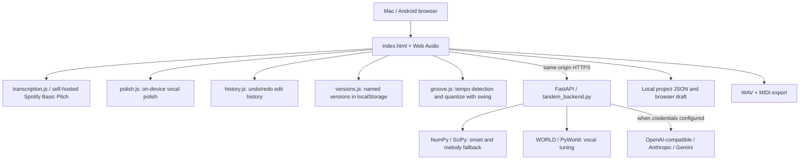

# Architecture and data contracts

Last reviewed: 2026-11-10. This describes the **implemented** app; planned architecture is in ROADMAP.md.

## System overview



Vercel runs `api/index.py` which imports `tandem_backend.app`. FastAPI serves the UI, manifest, service worker, the browser modules (transcription, polish, tuning, history), and endpoints. No independent database or music-generation worker is deployed. `vercel.json` configures function duration.

## Implemented API
| Route | Behavior | Authorization |
|---|---|---|
| GET / | Browser studio | Public |
| GET /api/health | Health metadata | Public |
| GET /api/config | Non-secret model/capability metadata | Public |
| POST /api/chat | Text LLM project edit plan | Requires shared token on Vercel |
| POST /api/analyze | Server heuristic melody/beatbox analysis | Public |
| POST /api/tune | WORLD monophonic voice pitch correction | Public |

The audio endpoints consume CPU. `request_guards.py` rate-limits them per client IP through Upstash Redis (in-process counters only off Vercel) and caps request bodies before any route reads them; see [SECURITY.md](SECURITY.md#request-limits-sec1). Per-IP limits are not per-user quotas: treat this as an experimental personal app, not a production multi-tenant API.

## Portable music schema (early internal format)
```json
{
  "format": "tandem-project", "version": 1,
  "bpm": 100, "instrument": "marimba", "melody_locked": true,
  "notes": [{"m": 60, "t": 0.0, "d": 0.45}],
  "drums": [{"k": "kick", "t": 0.0}]
}
```
`m` is MIDI pitch, `t` and `d` are seconds, drum `k` is kick/snare/hat. Original vocal/audio is **not** embedded in project JSON. The browser can save/open JSON and export rendered WAV or MIDI.

## Transcription and tuning
- `transcription.js` lazily imports Spotify Basic Pitch and its model. It resamples input AudioBuffer to **22,050 Hz** to avoid the previously reported 48-kHz error and returns `{m,t,d}`. Callers pass limits: `PROJECT_MELODY_LIMITS` (default, 60 s / 128 notes) for melody going into the project, `VOCAL_TARGET_LIMITS` (uncapped) for pitch-correction targets.
- The fallback `/api/analyze` uses autocorrelation for notes and energy-onset/spectral-centroid heuristics for drums. Both need quality evaluation.
- `tuning.js` (in the browser) tunes recordings of any length by sending `/api/tune` one overlapping 16 s chunk at a time and stitching the results (PERF.2). The server stays stateless.
- `polish.js` (in the browser) only changes EQ/gate/dynamics; it **does not** tune pitch. It replaced `/api/polish` in PERF.1 so recordings of any length are polished without an upload.
- `contour.js` (in the browser, VOX.3) is the pitch-contour editor's pure model: the sung pitch line from Basic Pitch's contour output, fragment merging, key/scale snapping, edge resizing, and a preview of what `/api/tune` will do to each note. `index.html` imports it at startup (it is precached), and `transcription.js` imports it for `detectVocalTargets`, which returns `{notes, contour}` with a confidence `c` on each note. See [AUDIO.md](AUDIO.md#pitch-contour-editor-vox3).
- `/api/tune` uses `world_tuning.py`, changing F0 while retaining WORLD's spectral envelope and aperiodicity. Default chromatic snapping (or snapping to `scale`); edited notes may be supplied as JSON targets, with `vibrato` setting how much of each note's vibrato survives. It accepts short isolated singing only; results can contain artifacts.

## Edit history (EDIT.1)
`history.js` is a pure module the studio script imports at startup (the inline script is `type="module"`). Every edit in `index.html` goes through `edit(label, fn)`, which serializes a snapshot before and after `fn` and records the pair with its label:

- What a snapshot holds: the project (`bpm`, `instrument`, `melody_locked`, `notes`, `drums`) and the vocal tuning targets (`vocalNotes` and the detected originals that Reset restores) and the tuning key/scale. Recorded edits: tapping a note or hit, + Note/+ Hit, Clear, tempo, instrument, melody lock, Load example, Open project, transcription results, AI chat actions (one entry per reply), Detect sung notes, the contour editor's target drags, resizes, arrow-key steps and deletes, key/scale changes, Snap notes to key, and Reset note edits.
- Undo/Redo buttons (disabled when empty; the title names the edit), Ctrl/Cmd+Z, Ctrl/Cmd+Shift+Z and Ctrl+Y. Shortcuts are ignored in text fields so they keep native text undo.
- A new edit clears redo; an edit that changed nothing (for example clearing an empty track, or a tempo clamped back to its value) is not recorded. The undo stack is capped at 100 edits.
- Vocal targets belong to the recording they were detected from. Loading or recording new audio removes targets from every stored snapshot (`rewrite`) and discards edits that become no-ops, so undo never applies old targets to a new recording.
- Not in history: the recordings and processed audio (polished/tuned results), the sung pitch contour (it belongs to the recording), transport and UI settings (mode, engine, tuning strength, Keep vibrato, presets), and the chat transcript. The history lives in memory for the page session; it is not saved in project files or the localStorage draft. Named versions (below) are the persistent counterpart.

## Named versions (EDIT.2)
`versions.js` is a pure store over an injected `Storage` (the studio passes `localStorage`, key `tandem-versions`). Save version stores the current project as a portable `tandem-project` object (no audio, no vocal targets) under a trimmed name of 1-60 characters, newest first, keeping at most 50 (the oldest is dropped). Restoring a stored version that lacks a tempo or instrument uses 100 bpm and piano, as Open project does. Each row restores or deletes one version. Restoring goes through `edit()`, so it is a single undoable edit labelled "Restore version: <name>". Deleting is not part of the edit history.
- Versions live only in that browser profile (ADR-006: no server-side storage); clearing site data removes them. Export a project file to move work between devices.
- A full storage quota fails the save with a message and leaves existing versions unchanged. Unparseable stored data is reported rather than overwritten. Entries the store does not recognise (a newer format or a hand edit) are hidden from the list but written back untouched on save and delete, and do not count towards the 50-version cap.

## Groove: Detect tempo and Quantize (ARR.1)
`groove.js` is pure (imported by `index.html` and the Node tests) and works on the project's own timing; the schema is unchanged, so playback, WAV/MIDI export and project files need nothing new.
- **Detect tempo** estimates a whole-number bpm in 60-180 from the note and drum onsets (at least four distinct onsets; otherwise it says so and changes nothing). Each candidate tempo is scored by how close the onsets sit to its eighth-note grid plus half the same score on its beat grid (Gaussian, 20 ms), each anchored at the best of the first four onsets and reduced by what random onsets would score on that grid. The chance term stops a finer grid (double tempo) from winning on sloppy timing; the beat term stops half tempo from winning when every onset is on the beat, since the half-tempo eighth grid would fit those just as well. An evenly spaced run (only eighths, say) cannot be told from the same notes at double or half the tempo, so it may come back an octave off (70 bpm eighths read as 140). Slow parts are affected beyond even runs: below about 80 bpm, quarter notes with an eighth on every second beat also read at double tempo (70 becomes 140), because the double-tempo beat grid fits every onset. Type the tempo in these cases. It sets the Tempo field as one undoable edit.
- **Quantize** snaps note and drum start times to a 1/4, 1/8 or 1/16 grid at the current tempo. The grid follows the beat the onsets agree on: of the onset phases within one beat, the one most onsets fit (ties to the earliest), anchored on the earliest onset in that phase, so leading silence is kept. The downbeats are told from the offbeats only by count: a pickup before the downbeat stays a pickup only when more onsets fall on the downbeats than on the offbeats. When the pickup's phase has as many onsets or more (a pickup into a run of even eighths gives it one more, or the same number when the run is odd; ties go to the earliest phase), the pickup's phase is taken as the beat, so the real downbeats are treated as offbeats and swing moves them. A note that snaps before 0 s is clamped to 0. Swing (0-100%) moves the second step of each pair from halfway (straight) to two thirds (triplet feel); it does nothing on the 1/4 grid. Strength (100/75/50%) moves each event that fraction of the way. Durations are kept. Events that land on the same grid point merge: same pitch keeps the longer note, same drum keeps one hit. It is one undoable edit labelled with the grid and swing; quantizing an already-quantized project records nothing.
- Swing is baked into the note times, not stored as a playback setting, so exports and other apps hear the same feel. The settings (grid, swing, strength) are UI state, not part of the project or history. Quantize is a user edit, so melody lock (which guards AI edits) does not block it.

## LLM orchestration
`invoke_llm` supports `openai-compatible` (including gateways and local OpenAI-style endpoints), `anthropic`, and `gemini`, selected through environment variables. Models return JSON; `normalize_actions` allowlists edit types and clamps values. Melody lock rejects AI modifications to melody note events by default. The client applies the validated actions as one undoable edit (see Edit history).

The assistant is currently **text only** and uses symbolic notes/drums, not direct multimodal audio understanding. A future music-generation provider is merely a disabled configuration slot—not an integration.

## Ownership and boundaries
- Browser: microphone capture, display, editable music, Basic Pitch transcription, playback/export, local draft.
- Backend: voice DSP, tuning, text-model invocation, action validation and expense guard.
- External model host: optional text LLM; keys stored server-side. Browser never receives `TANDEM_API_KEY`.
- No account system/cloud projects: there is no server-side database, and serverless storage must be treated as ephemeral.

## File map
| File | Purpose |
|---|---|
| index.html | Main studio UI and browser audio |
| transcription.js | Browser model adapter, resampling and note conversion |
| history.js | Undo/redo edit history (pure; imported by index.html and Node tests) |
| versions.js | Named project versions in localStorage (pure; imported by index.html and Node tests) |
| groove.js | Tempo detection and quantize with swing (pure; imported by index.html and Node tests) |
| tandem_backend.py | FastAPI, DSP, LLM adapters, validation |
| world_tuning.py | WORLD tuning |
| request_guards.py | Rate limits (Upstash Redis), body-size caps |
| api/index.py | Vercel FastAPI entry |
| requirements.txt | Python dependencies including pyworld-prebuilt |
| tests/ | Python and Node checks |
| .github/workflows/tests.yml | GitHub Actions tests (backend, transcription, e2e) |
| e2e/ | Playwright browser end-to-end tests against the real app |
