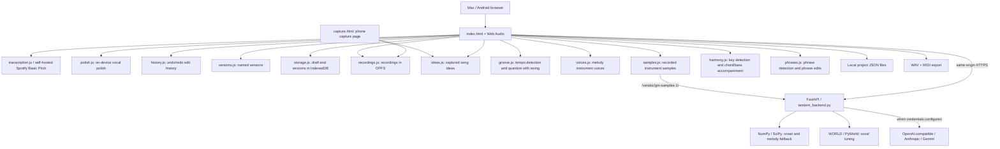

# Architecture and data contracts

Last reviewed: 2026-11-10. This describes the **implemented** app; planned architecture is in ROADMAP.md.

## System overview



**Direction (ADR-011, ADR-012).** Tandem is local-first: the draft, versions and recordings are already kept on the device in IndexedDB/OPFS (STORE.2a, implemented). Implemented from source, needs the operator's QA: a Mac app that runs this same backend on `127.0.0.1` in a native window (DESK.1, see below). Planned: no hosted limits, projects as files and AI keys in the Keychain in that app (DESK.2-DESK.3, AI.4), then local AI audio models in that backend (Demucs, MusicGen-Melody, RAVE). The Vercel deployment stays as the hosted web mode. See ROADMAP.md sections 6-8.

Vercel runs `api/index.py` which imports `tandem_backend.app`. FastAPI serves the UI, manifest, service worker, the browser modules (transcription, polish, tuning, history), and endpoints. No independent database or music-generation worker is deployed. `vercel.json` configures function duration.

## Implemented API
| Route | Behavior | Authorization |
|---|---|---|
| GET / | Browser studio | Public |
| GET /api/health | Health metadata | Public |
| GET /api/config | Non-secret model/capability metadata | Public |
| POST /api/chat | Text LLM project edit plan | Requires shared token on Vercel |
| POST /api/analyze | Server heuristic melody/beatbox analysis | Public |
| POST /api/tune | WORLD monophonic voice pitch correction | Public |

The audio endpoints consume CPU. `request_guards.py` rate-limits them per client IP through Upstash Redis (in-process counters only off Vercel) and caps request bodies before any route reads them; see [SECURITY.md](SECURITY.md#request-limits-sec1). Per-IP limits are not per-user quotas: treat this as an experimental personal app, not a production multi-tenant API.

## Portable music schema (early internal format)
```json
{
  "format": "tandem-project", "version": 1,
  "bpm": 100, "instrument": "marimba", "melody_locked": true,
  "notes": [{"m": 60, "t": 0.0, "d": 0.45}],
  "drums": [{"k": "kick", "t": 0.0}],
  "harmony": [{"m": 52, "t": 0.0, "d": 2.26}], "harmony_instrument": "piano"
}
```
`m` is MIDI pitch, `t` and `d` are seconds, drum `k` is kick/snare/hat. `harmony` and `harmony_instrument` (ARR.1c) are optional and the format version stays 1: a project, version or draft without them has no harmony, on piano. Opening a project or restoring a version whose `harmony` is not a list, or whose `harmony_instrument` is not one of the instruments, is refused. Original vocal/audio is **not** embedded in project JSON. The browser can save/open JSON and export rendered WAV or MIDI.

## Transcription and tuning
- `transcription.js` lazily imports Spotify Basic Pitch and its model. It resamples input AudioBuffer to **22,050 Hz** to avoid the previously reported 48-kHz error and returns `{m,t,d}`. Callers pass limits: `PROJECT_MELODY_LIMITS` (default, 60 s / 128 notes) for melody going into the project, `VOCAL_TARGET_LIMITS` (uncapped) for pitch-correction targets.
- The fallback `/api/analyze` uses autocorrelation for notes and energy-onset/spectral-centroid heuristics for drums. Both need quality evaluation.
- `tuning.js` (in the browser) tunes recordings of any length by sending `/api/tune` one overlapping 16 s chunk at a time and stitching the results (PERF.2). The server stays stateless.
- `polish.js` (in the browser) only changes EQ/gate/dynamics; it **does not** tune pitch. It replaced `/api/polish` in PERF.1 so recordings of any length are polished without an upload.
- `contour.js` (in the browser, VOX.3) is the pitch-contour editor's pure model: the sung pitch line from Basic Pitch's contour output, fragment merging, key/scale snapping, edge resizing, and a preview of what `/api/tune` will do to each note. `index.html` imports it at startup (it is precached), and `transcription.js` imports it for `detectVocalTargets`, which returns `{notes, contour}` with a confidence `c` on each note. See [AUDIO.md](AUDIO.md#pitch-contour-editor-vox3).
- `/api/tune` uses `world_tuning.py`, changing F0 while retaining WORLD's spectral envelope and aperiodicity. Default chromatic snapping (or snapping to `scale`); edited notes may be supplied as JSON targets, with `vibrato` setting how much of each note's vibrato survives. It accepts short isolated singing only; results can contain artifacts.

## Edit history (EDIT.1)
`history.js` is a pure module the studio script imports at startup (the inline script is `type="module"`). Every edit in `index.html` goes through `edit(label, fn)`, which serializes a snapshot before and after `fn` and records the pair with its label:

- What a snapshot holds: the project (`bpm`, `instrument`, `melody_locked`, `notes`, `drums`, `harmony`, `harmony_instrument`) and the vocal tuning targets (`vocalNotes` and the detected originals that Reset restores) and the tuning key/scale. Recorded edits: tapping a note or hit, + Note/+ Hit, Clear, tempo, instrument, melody lock, Load example, Open project, transcription results, AI chat actions (one entry per reply), Detect sung notes, the contour editor's target drags, resizes, arrow-key steps and deletes, key/scale changes, Snap notes to key, Reset note edits, and the harmony part's Generate, Clear, instrument change and note taps.
- Undo/Redo buttons (disabled when empty; the title names the edit), Ctrl/Cmd+Z, Ctrl/Cmd+Shift+Z and Ctrl+Y. Shortcuts are ignored in text fields so they keep native text undo.
- A new edit clears redo; an edit that changed nothing (for example clearing an empty track, or a tempo clamped back to its value) is not recorded. The undo stack is capped at 100 edits.
- Vocal targets belong to the recording they were detected from. Loading or recording new audio removes targets from every stored snapshot (`rewrite`) and discards edits that become no-ops, so undo never applies old targets to a new recording.
- Not in history: the recordings and processed audio (polished/tuned results), the sung pitch contour (it belongs to the recording), transport and UI settings (mode, engine, tuning strength, Keep vibrato, presets), and the chat transcript. The history lives in memory for the page session; it is not saved in project files or the stored draft. Named versions (below) are the persistent counterpart.

## Named versions (EDIT.2)
`versions.js` is a pure async store over the key-value store from `storage.js` (key `versions` in IndexedDB; see On-device storage below). Saving and deleting read and write the list in one transaction, so a version saved in another tab at the same moment is kept. Save version stores the current project as a portable `tandem-project` object (no audio, no vocal targets), with links to the recordings loaded at the time next to it (see Recordings below) under a trimmed name of 1-60 characters, newest first, keeping at most 50 (the oldest is dropped). Restoring a stored version that lacks a tempo or instrument uses 100 bpm and piano, as Open project does. Each row restores or deletes one version. Restoring goes through `edit()`, so it is a single undoable edit labelled "Restore version: <name>". A version saved with a recording also brings that recording back (that part is not undoable, like loading any recording); a version saved without one keeps the current recording. Deleting is not part of the edit history.
- Versions live only in that browser profile (ADR-011: no server-side storage); clearing site data removes them. Export a project file to move work between devices.
- A full storage quota fails the save with a message and leaves existing versions unchanged. Unparseable stored data is reported rather than overwritten. Entries the store does not recognise (a newer format or a hand edit) are hidden from the list but written back untouched on save and delete, and do not count towards the 50-version cap.

## On-device storage (STORE.2a)
`storage.js` opens the IndexedDB database `tandem` with one object store, `kv`, and wraps it as a small key-value store (`get`, `set`, `update`, `setMany`). Each call starts its transaction synchronously, so writes land in the order they were made, and `update` reads, changes and writes a key in one transaction (nothing is written if the change throws).
- **Keys.** `draft` holds the current project (the same fields as a project file, without `format`/`version`); `versions` holds the named versions list; `draft-audio` holds the draft's recording links (below).
- **Draft.** Every `update()` writes the draft. At start-up the studio opens the database, migrates, reads the stored draft and only then starts writing, so the default project never overwrites a saved draft. The page is `inert` (ignores input) until the stored draft has been read, so an edit made in those few milliseconds cannot be overwritten by it. A failed write is reported once in the status line.
- **Migration from `localStorage`.** On every start, a `tandem-draft` or `tandem-versions` key left by an older Tandem (or written later by an old cached copy) is brought in and then removed from `localStorage`: versions are merged by id (the IndexedDB copy wins, the list stays newest first, unrecognised entries are carried over untouched) and a legacy draft replaces the stored one. Versions that cannot be parsed stay in `localStorage` and are reported. If the versions already in IndexedDB are unreadable, nothing is merged, both copies are kept, the problem is reported and the draft still migrates and saves; a draft the app could never open is dropped, as before. If the IndexedDB write fails, `localStorage` keeps everything. Settings (`tandem-api`) stay in `localStorage`.
- **Persistence.** The Versions panel says whether the browser has promised to keep the site's storage (`navigator.storage.persisted()`). Save version asks for it (`persist()`); browsers may grant it silently, prompt or refuse. Without it the browser may clear the data under storage pressure, and the panel says to export project files.
- **No IndexedDB.** If the database cannot be opened (no IndexedDB, or it fails), the status line and Versions panel say saving on this device is unavailable; the studio still edits, plays and exports, and a legacy `localStorage` draft is shown but not saved.

### Phone capture (MOB.1, ADR-013)
`capture.html`, served at `/capture`, is a separate light page for catching song ideas on a phone. It opens the same IndexedDB store and OPFS directory as the studio (same origin), so ideas and studio work share one storage. Its own manifest (`capture.webmanifest`, start URL `./capture`) makes "Add to Home Screen" from that page open capture; the studio's manifest lists it as a shortcut where browsers support shortcuts (Android Chrome).
- **Record.** One large button. `MediaRecorder` hands over its data every second; Stop ends the take, and so does the page being hidden (the phone locks or another app comes up), since a web app loses the microphone there. The take's length is the wall-clock time recorded.
- **Keep.** The recording is stored by `recordings.js` and its idea entry `{id, name, savedAt, duration, audio}` is added to the list under the IndexedDB key `ideas` (newest first) inside one `recordings.hold()`, so collection cannot remove the file before it is linked. If storing fails, the status line says why and the take is offered as a download, never dropped.
- **Ideas.** Each is listed with its name (or the time it was recorded) and length, and can be played, renamed, deleted (a second tap confirms) and opened in the studio. Entries this version does not recognise are hidden but kept; an unreadable list is an error and is never overwritten.
- **Offline and install (MOB.2).** `sw.js` precaches the studio, the capture page, every module either imports at start-up, both manifests and the icons, so both open and record with no network once opened. Other same-origin GETs are network first with the cache as the offline copy; a navigation with a query string (`./?idea=<id>`) is stored once under its address without the query and falls back to that page. Cache lookups ignore `Vary`, because the server sends `Vary: Origin` (CORS) and a module import carries an `Origin` header the precache request did not. Files under `/vendor/` (Basic Pitch, instrument samples) never change at a given path, so they are cached on first use in a separate `tandem-vendor-1` cache, served from it first, and kept when `CACHE` is bumped. Both manifests list 192 and 512 px icons and a maskable 512 px icon; both pages link `icons/apple-touch-icon.png` (180 px, opaque) for iOS, which ignores manifest icons. After the first idea kept in a visit, the capture page asks for persistent storage (`navigator.storage.persist()`) and shows whether the browser granted it.
- **Open in studio.** The link `./?idea=<id>` makes the studio, while it is still inert at start-up, save the current draft as the version "Before <idea>" (with its recordings) if it has notes, drums, harmony or audio, then start a new draft with the idea's recording loaded, and remove the query from the address.
- **No device storage.** Where OPFS is refused (a private window in Safari, Playwright's WebKit), the page says ideas cannot be kept and does not record.

### Recordings (STORE.2a)
`recordings.js` keeps the original, polished and tuned audio as files in the Origin Private File System, in a `recordings` directory, each named by the SHA-256 of its bytes and written once, so the same audio linked from the draft and several versions is stored once. A link is `{id, type}` (hash and MIME type).
- **Links, not embedded audio.** The draft's links live under the IndexedDB key `draft-audio` as `{original, polished, tuned}`, not in the project: `/api/chat` validates the project with extra keys forbidden, and project files stay audio-free. Each version entry carries its own `audio` links beside its `project`.
- **When it is written.** After a recording or import decodes, after Polish and after Tune, the current audio is stored and the draft's links are replaced. If newer audio replaced it while the files were being written, that save writes no links (the newer save does). Save version stores the current audio and links it from the new version.
- **Start-up.** While the page is still inert, the draft's recordings are read back and loaded: Play original, Polished and Tuned come back as they were. A linked file that is no longer on the device is reported in the status line; the project is kept.
- **Garbage collection.** At start-up and after a version is deleted, files linked from neither the draft nor any stored version (recognised or not) are deleted. Storing a file and linking it hold a shared Web Lock and collection takes it exclusively, so a file another tab has just stored but not yet linked is never collected. Without Web Locks, collection is skipped.
- **Errors.** A full quota while writing is reported ("Browser storage is full..."), a half-written file is removed, and the recording keeps playing for the session. Save version stores the recordings and the version together, so if a recording cannot be stored the version is not saved either and the status line says why; delete older versions to make room, then save again. Without OPFS (`navigator.storage.getDirectory`), the status line says recordings last only until the page is closed and everything else still saves.
- **Garbage collection keeps ideas.** Files linked from a captured idea (MOB.1, `ideas.js`) are kept too, by the studio and by the capture page, which collects after deleting an idea.
- **Not verified:** Safari. Writing OPFS files from the page needs `createWritable`, which older Safari versions lack (they offer only the worker-only sync access handle), so recordings may not be kept there; no real Safari or iOS device has been tried.

## Groove: Detect tempo and Quantize (ARR.1)
`groove.js` is pure (imported by `index.html` and the Node tests) and works on the project's own timing; the schema is unchanged, so playback, WAV/MIDI export and project files need nothing new.
- **Detect tempo** estimates a whole-number bpm in 60-180 from the note and drum onsets (at least four distinct onsets; otherwise it says so and changes nothing). Each candidate tempo is scored by how close the onsets sit to its eighth-note grid plus half the same score on its beat grid (Gaussian, 20 ms), each anchored at the best of the first four onsets and reduced by what random onsets would score on that grid. The chance term stops a finer grid (double tempo) from winning on sloppy timing; the beat term stops half tempo from winning when every onset is on the beat, since the half-tempo eighth grid would fit those just as well. An evenly spaced run (only eighths, say) cannot be told from the same notes at double or half the tempo, so it may come back an octave off (70 bpm eighths read as 140). Slow parts are affected beyond even runs: below about 80 bpm, quarter notes with an eighth on every second beat also read at double tempo (70 becomes 140), because the double-tempo beat grid fits every onset. Type the tempo in these cases. It sets the Tempo field as one undoable edit.
- **Quantize** snaps note and drum start times to a 1/4, 1/8 or 1/16 grid at the current tempo. The grid follows the beat the onsets agree on: of the onset phases within one beat, the one most onsets fit (ties to the earliest), anchored on the earliest onset in that phase, so leading silence is kept. The downbeats are told from the offbeats only by count: a pickup before the downbeat stays a pickup only when more onsets fall on the downbeats than on the offbeats. When the pickup's phase has as many onsets or more (a pickup into a run of even eighths gives it one more, or the same number when the run is odd; ties go to the earliest phase), the pickup's phase is taken as the beat, so the real downbeats are treated as offbeats and swing moves them. A note that snaps before 0 s is clamped to 0. Swing (0-100%) moves the second step of each pair from halfway (straight) to two thirds (triplet feel); it does nothing on the 1/4 grid. Strength (100/75/50%) moves each event that fraction of the way. Durations are kept. Events that land on the same grid point merge: same pitch keeps the longer note, same drum keeps one hit. It is one undoable edit labelled with the grid and swing; quantizing an already-quantized project records nothing.
- Swing is baked into the note times, not stored as a playback setting, so exports and other apps hear the same feel. The settings (grid, swing, strength) are UI state, not part of the project or history. Quantize is a user edit, so melody lock (which guards AI edits) does not block it.

## Instrument voices (ARR.1b)
`voices.js` is pure (imported by `index.html` and the Node tests) and holds the melody instruments: piano, marimba, strings, bass, 8-bit (`chip`), organ, guitar and flute. Each voice is a few oscillator layers (wave type, frequency ratio, detune and weight), an amplitude envelope (attack, decay, sustain, release), an optional low-pass filter whose cutoff sweeps with the note (a ratio of the note frequency) and optional delayed vibrato on the layers' detune. `planNote` turns a note into plain numbers and `playNote` builds the Web Audio graph from them, the same way for live playback and the 22,050 Hz WAV export, so both sound alike.
- Layer weights are normalised to the voice's peak gain (0.10-0.16, like the old single oscillators) so a voice change does not change loudness much and exports do not clip.
- A note shorter than the attack or decay releases from the level it had reached. Voices that decay to silence (marimba, guitar) end shortly after they fade instead of holding a silent release.
- Partials at or above 95% of Nyquist are dropped and filter cutoffs are clamped below it, so high notes do not alias in the lower-rate export. Notes from MIDI 124 up (above about 10.5 kHz) have no layer left at 22,050 Hz, so they play live but are silent in the WAV; the note editor and AI edits stay within 36-96.
- `INSTRUMENTS` in `voices.js` is the instrument list. The Instrument menu is built from it, opening a project file or restoring a version with any other instrument is rejected (a browser draft with one keeps its notes and says to choose an instrument), and `tandem_backend.py` keeps the same tuple for `ChatProject`, `normalize_actions` and the system prompt. A Node test fails if the two lists differ.
- The oscillator voices are now the fallback. When the samples for a part are available, `samples.js` plays recorded General MIDI samples instead (SND.1; see AUDIO.md). Whether either sounds good is a listening judgement that has not been made on real devices (see TESTING.md).

## Sampled instruments (SND.1)
`samples.js` is imported statically by `index.html` and by the Node tests. It loads `/vendor/gm-samples-1/manifest.json` and the MP3 samples for the parts a project uses, decodes them, and schedules them with `playSample` (melody and harmony notes) and `playDrumSample`, for both live playback and the offline WAV export. The samples are built by `tools/gm-samples/build.py` and served by an allowlisted route in `tandem_backend.py` that serves only files listed in `vendor/gm-samples-1/SHA256SUMS`. `sw.js` precaches `samples.js`. A part without loaded samples falls back to `voices.js`.

## Harmony (ARR.1c)
`harmony.js` is pure (imported by `index.html` and the Node tests). Generate in the Harmony track builds an accompaniment from the melody and stores it as the project's `harmony` notes, the same `{m,t,d}` shape as the melody, so it is edited, undone, saved, versioned and exported like any other part.
- **Key.** By default the key is detected from the melody: the duration-weighted pitch-class histogram is correlated with the Krumhansl-Kessler major and minor profiles for all 12 tonics and the best match wins. It needs at least three notes with two different pitch classes; otherwise Generate asks for a key. The key menu can instead name any of the 24 major and minor keys.
- **Chords.** One chord per 4/4 bar at the project tempo, with bars starting at the first melody note (a pickup shifts the bar lines; quantize first and start on a downbeat for the best fit). Each bar takes the diatonic triad (major keys: I ii iii IV V vi; minor keys: i III iv V VI VII, with the harmonic-minor V; no diminished triads) that best fits the melody notes it overlaps: chord tones count for, other notes of the key count half against and notes outside the key count fully against, weighted by overlap in beats, a note sounding on the downbeat counting double, plus a small preference for I, V and IV. A bar with no melody keeps the previous chord.
- **Styles.** Chords: a close-position triad in C3-G4 per bar, each voicing chosen to move the voices least from the previous one. Bass line: the root (C2-B2) on beat 1 and the fifth above it on beat 3. Notes end at 94% of their slot so repeated pitches re-strike. A part over 1024 notes (the `/api/chat` limit; about 341 bars of chords) is refused with a message instead of generated.
- **Part.** Generating replaces the whole part as one undoable edit labelled with the style and key; the status line lists the chords. Tapping a harmony note removes it. The part has its own instrument from `INSTRUMENTS` (generating a bass line into an empty part on the default piano switches it to bass). Playback and WAV export play it through a 0.6 gain bus so a triad sits under the melody without clipping; MIDI export writes it on channel 2 (melody on 1, drums on 10).
- The AI sees the harmony part in the project it is sent but has no action that edits it, so melody lock does not apply to it; an AI transpose or note replacement does not regenerate it. Whether the generated parts sound musical is a listening judgement not yet made on real devices.


## Phrases (ARR.1d)
`phrases.js` is pure (imported by `index.html` and the Node tests). The Melody track lists the melody's phrases under its roll; choosing one marks its notes and switches on the phrase tools.
- **Detection.** Notes are taken in time order; a note that starts a beat or more (at the project tempo, with 1 ms tolerance) after the latest end so far starts a new phrase, so a long note bridges the notes under it. Changing the tempo can split or join phrases, and so can a phrase edit: a phrase moved or copied until less than a beat separates it from its neighbour joins that neighbour, and the choice then covers the joined phrase (undo separates them again). Legato singing with no rests is one phrase.
- **Edits.** Move a beat earlier or later, transpose by a semitone or an octave, and Copy to end, which appends the phrase a whole number of 4/4 bars after the original and after the melody's last note, so the copy keeps its place in the bar. Each is one undoable edit through `edit()`. A move before 0 s or past 600 s, a transpose outside MIDI 0..127 (refused rather than clamped, so the phrase keeps its shape) and a copy past 1024 melody notes or 600 s are refused with a message. Phrase notes keep their positions in the `notes` array, and copies are appended.
- **Choice.** The chosen phrase is remembered by one of its notes across phrase edits, so it stays chosen after it moves or is copied (the copy becomes the choice). Any other edit, undo or redo clears it.
- **Harmony.** Phrase edits change only the melody. The harmony part is left as it is and the status line suggests generating it again (ADR-010: harmony does not follow melody edits).

## Mac app (DESK.1)
`tandem_desktop/` is the launcher. `__init__.py` has no pywebview import, so it is tested on any platform: `load_port` reads or creates `desktop.json` (one port, kept across launches, because the origin `http://127.0.0.1:<port>` owns the IndexedDB and OPFS data), `bind` opens a socket on `127.0.0.1` only, `guarded_app` wraps `tandem_backend.app` and answers `421 Unknown host` unless the Host header is exactly `127.0.0.1:<port>`, `allow_media` decides WebKit's capture requests (microphone only, own origin only), and `start_server`/`stop_server` run uvicorn on the pre-bound socket in a thread and set `TANDEM_RUNTIME=desktop`, which `/api/config` reports as `"runtime": "desktop"`. `__main__.py` opens the pywebview window with persistent storage and downloads allowed, adds WebKit's `webView:requestMediaCapturePermissionForOrigin:initiatedByFrame:type:decisionHandler:` method to pywebview's Cocoa delegate so the microphone answer comes from `allow_media` rather than a WebKit prompt on every launch, and stops the server when the window closes. `index.html` and `tandem_backend.py` are unchanged apart from the `runtime` field.

## LLM orchestration
`invoke_llm` supports `openai-compatible` (including gateways and local OpenAI-style endpoints), `anthropic`, and `gemini`, selected through environment variables. Models return JSON; `normalize_actions` allowlists edit types and clamps values. Melody lock rejects AI modifications to melody note events by default. The client applies the validated actions as one undoable edit (see Edit history).

The assistant is currently **text only** and uses symbolic notes/drums, not direct multimodal audio understanding. A future music-generation provider is merely a disabled configuration slot—not an integration.

## Ownership and boundaries
- Browser: microphone capture, display, editable music, Basic Pitch transcription, playback/export, the draft and versions in IndexedDB.
- Backend: voice DSP, tuning, text-model invocation, action validation and expense guard.
- External model host: optional text LLM; keys stored server-side. Browser never receives `TANDEM_API_KEY`.
- No account system/cloud projects: there is no server-side database, and serverless storage must be treated as ephemeral. ADR-011 keeps it that way: durable storage is planned on the device and in storage the user brings.

## File map
| File | Purpose |
|---|---|
| index.html | Main studio UI and browser audio |
| transcription.js | Browser model adapter, resampling and note conversion |
| history.js | Undo/redo edit history (pure; imported by index.html and Node tests) |
| versions.js | Named project versions (pure over the storage.js key-value store; imported by index.html and Node tests) |
| storage.js | IndexedDB key-value store, migration from localStorage, persistent-storage status (STORE.2a) |
| recordings.js | Recordings in OPFS named by SHA-256, links, garbage collection under Web Locks (STORE.2a) |
| ideas.js | Song ideas captured on the phone: list, rename, delete, recording links (MOB.1; pure over the storage.js key-value store) |
| capture.html | Phone capture page at `/capture`, with its own `capture.webmanifest` (MOB.1, ADR-013) |
| icons/ | App icons: SVG sources and the PNGs `tools/icons/build.py` renders from them, served by an allowlisted `/icons/` route (MOB.2) |
| sw.js | Service worker: precached app shell, network first with offline copy, `/vendor/` cached on first use (MOB.2) |
| groove.js | Tempo detection and quantize with swing (pure; imported by index.html and Node tests) |
| samples.js | Recorded instrument samples for playback and WAV export, with fallback to voices.js (pure; imported by index.html and Node tests) |
| vendor/gm-samples-1/ | Self-hosted General MIDI samples, manifest, licenses and SHA256SUMS, served by an allowlisted route (SND.1) |
| voices.js | Melody instrument voices for playback and WAV export (pure; imported by index.html and Node tests) |
| harmony.js | Key detection and chord/bass accompaniment generation (pure; imported by index.html and Node tests) |
| phrases.js | Melody phrase detection and phrase move/copy/transpose (pure; imported by index.html and Node tests) |
| tandem_backend.py | FastAPI, DSP, LLM adapters, validation |
| world_tuning.py | WORLD tuning |
| request_guards.py | Rate limits (Upstash Redis), body-size caps |
| tandem_desktop/ | Mac app launcher: fixed loopback port, Host check, microphone rule, native window (DESK.1) |
| requirements-desktop.txt | requirements.txt plus pywebview, for the Mac app |
| api/index.py | Vercel FastAPI entry |
| requirements.txt | Python dependencies including pyworld-prebuilt |
| tests/ | Python and Node checks |
| .github/workflows/tests.yml | GitHub Actions tests (backend, transcription, e2e) |
| e2e/ | Playwright browser end-to-end tests against the real app |
