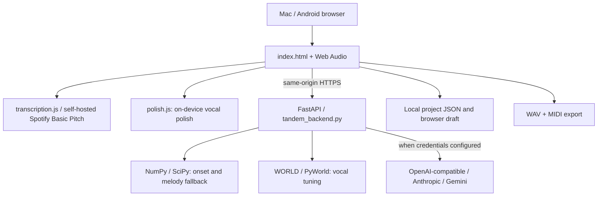

# Architecture and data contracts

Last reviewed: 2026-11-09. This describes the **implemented** app; planned architecture is in ROADMAP.md.

## System overview



Vercel runs `api/index.py` which imports `tandem_backend.app`. FastAPI serves the UI, manifest, service worker, browser transcription and polish modules, and endpoints. No independent database or music-generation worker is deployed. `vercel.json` configures function duration.

## Implemented API
| Route | Behavior | Authorization |
|---|---|---|
| GET / | Browser studio | Public |
| GET /api/health | Health metadata | Public |
| GET /api/config | Non-secret model/capability metadata | Public |
| POST /api/chat | Text LLM project edit plan | Requires shared token on Vercel |
| POST /api/analyze | Server heuristic melody/beatbox analysis | Public |
| POST /api/tune | WORLD monophonic voice pitch correction | Public |

The audio endpoints consume CPU. `request_guards.py` rate-limits them per client IP through Upstash Redis (in-process counters only off Vercel) and caps request bodies before any route reads them; see [SECURITY.md](SECURITY.md#request-limits-sec1). Per-IP limits are not per-user quotas: treat this as an experimental personal app, not a production multi-tenant API.

## Portable music schema (early internal format)
```json
{
  "format": "tandem-project", "version": 1,
  "bpm": 100, "instrument": "marimba", "melody_locked": true,
  "notes": [{"m": 60, "t": 0.0, "d": 0.45}],
  "drums": [{"k": "kick", "t": 0.0}]
}
```
`m` is MIDI pitch, `t` and `d` are seconds, drum `k` is kick/snare/hat. Original vocal/audio is **not** embedded in project JSON. The browser can save/open JSON and export rendered WAV or MIDI.

## Transcription and tuning
- `transcription.js` lazily imports Spotify Basic Pitch and its model. It resamples input AudioBuffer to **22,050 Hz** to avoid the previously reported 48-kHz error and returns `{m,t,d}`. Callers pass limits: `PROJECT_MELODY_LIMITS` (default, 60 s / 128 notes) for melody going into the project, `VOCAL_TARGET_LIMITS` (uncapped) for pitch-correction targets.
- The fallback `/api/analyze` uses autocorrelation for notes and energy-onset/spectral-centroid heuristics for drums. Both need quality evaluation.
- `tuning.js` (in the browser) tunes recordings of any length by sending `/api/tune` one overlapping 16 s chunk at a time and stitching the results (PERF.2). The server stays stateless.
- `polish.js` (in the browser) only changes EQ/gate/dynamics; it **does not** tune pitch. It replaced `/api/polish` in PERF.1 so recordings of any length are polished without an upload.
- `/api/tune` uses `world_tuning.py`, changing F0 while retaining WORLD's spectral envelope and aperiodicity. Default chromatic snapping; edited notes may be supplied as JSON targets. It accepts short isolated singing only; results can contain artifacts.

## LLM orchestration
`invoke_llm` supports `openai-compatible` (including gateways and local OpenAI-style endpoints), `anthropic`, and `gemini`, selected through environment variables. Models return JSON; `normalize_actions` allowlists edit types and clamps values. Melody lock rejects AI modifications to melody note events by default. The client applies the validated actions with undo.

The assistant is currently **text only** and uses symbolic notes/drums, not direct multimodal audio understanding. A future music-generation provider is merely a disabled configuration slot—not an integration.

## Ownership and boundaries
- Browser: microphone capture, display, editable music, Basic Pitch transcription, playback/export, local draft.
- Backend: voice DSP, tuning, text-model invocation, action validation and expense guard.
- External model host: optional text LLM; keys stored server-side. Browser never receives `TANDEM_API_KEY`.
- No account system/cloud projects: there is no server-side database, and serverless storage must be treated as ephemeral.

## File map
| File | Purpose |
|---|---|
| index.html | Main studio UI and browser audio |
| transcription.js | Browser model adapter, resampling and note conversion |
| tandem_backend.py | FastAPI, DSP, LLM adapters, validation |
| world_tuning.py | WORLD tuning |
| request_guards.py | Rate limits (Upstash Redis), body-size caps |
| api/index.py | Vercel FastAPI entry |
| requirements.txt | Python dependencies including pyworld-prebuilt |
| tests/ | Python and Node checks |
| .github/workflows/tests.yml | GitHub Actions tests (backend, transcription, e2e) |
| e2e/ | Playwright browser end-to-end tests against the real app |
