# Architecture and data contracts

Last reviewed: 2026-11-10. This describes the **implemented** app; planned architecture is in ROADMAP.md.

## System overview

```mermaid
flowchart TD
  User[Mac / Android browser] --> UI[index.html + Web Audio]
  UI --> Basic[transcription.js / self-hosted Spotify Basic Pitch]
  UI --> Polish[polish.js: on-device vocal polish]
  UI --> History[history.js: undo/redo edit history]
  UI --> Versions[versions.js: named versions]
  UI --> Storage[storage.js: draft and versions in IndexedDB]
  UI --> Recordings[recordings.js: recordings in OPFS]
  Capture[capture.html: phone capture page] --> Ideas[ideas.js: captured song ideas]
  Capture --> Recordings
  UI --> Ideas
  Capture --> Bundle[bundle.js: Tandem files, .tandem.zip]
  UI --> Bundle
  UI --> Groove[groove.js: tempo detection and quantize with swing]
  UI --> Voices[voices.js: melody instrument voices]
  UI --> Samples[samples.js: recorded instrument samples]
  Samples -->|/vendor/gm-samples-1/| API
  UI --> Harmony[harmony.js: key detection, chord/bass accompaniment, chord symbols, harmony lines]
  UI --> Phrases[phrases.js: phrase detection and phrase edits]
  UI -->|same-origin HTTPS| API[FastAPI / tandem_backend.py]
  API --> DSP[NumPy / SciPy: onset and melody fallback]
  API --> World[WORLD / PyWorld: vocal tuning]
  API -->|when credentials configured| LLM[OpenAI-compatible / Anthropic / Gemini]
  UI --> Local[Local project JSON files]
  UI --> Export[daw.js: WAV, stems zip, multi-track MIDI]
  UI --> Notation[notation.js: MusicXML score]
  UI --> DawProject[dawproject.js: DAWproject file]
```



**Direction (ADR-011, ADR-012).** Tandem is local-first: the draft, versions and recordings are already kept on the device in IndexedDB/OPFS (STORE.2a, implemented). Implemented from source, needs the operator's QA: a Mac app that runs this same backend on `127.0.0.1` in a native window (DESK.1, see below). Planned: no hosted limits, projects as files and AI keys in the Keychain in that app (DESK.2-DESK.3, AI.4), then local AI audio models in that backend (Demucs, MusicGen-Melody, RAVE). The Vercel deployment stays as the hosted web mode. See ROADMAP.md sections 6-8.

Vercel runs `api/index.py` which imports `tandem_backend.app`. FastAPI serves the UI, manifest, service worker, the browser modules (transcription, polish, tuning, history), and endpoints. No independent database or music-generation worker is deployed. `vercel.json` configures function duration.

## Implemented API
| Route | Behavior | Authorization |
|---|---|---|
| GET / | Browser studio, with a Content-Security-Policy (SEC.7) | Public |
| GET /capture | Phone capture page, with a Content-Security-Policy (SEC.7) | Public |
| GET /api/health | Health metadata | Public |
| GET /api/config | Non-secret model/capability metadata | Public |
| POST /api/chat | Text LLM project edit plan | Requires shared token on Vercel |
| POST /api/analyze | Server heuristic melody/beatbox analysis (beats are read on the device by `beatbox.js` unless Server is chosen, SEC.6) | Public |
| POST /api/tune | WORLD monophonic voice pitch correction | Public |

Both pages are sent by `page_response`, which reads the file and adds the policy `page_policy` builds from it: scripts from this origin, Blob URLs (the AudioWorklets) and WebAssembly, and the page's inline module script by its SHA-256 hash, so no injected inline script or event handler runs; see `docs/SECURITY.md`.

The audio endpoints consume CPU. `request_guards.py` rate-limits them (and, after the token check, `/api/chat` in a bucket of its own) per client IP through Upstash Redis (in-process counters only off Vercel) and caps request bodies before any route reads them; see [SECURITY.md](SECURITY.md#request-limits-sec1). Per-IP limits are not per-user quotas: treat this as an experimental personal app, not a production multi-tenant API.

## Portable music schema (early internal format)
```json
{
  "format": "tandem-project", "version": 1,
  "bpm": 100, "instrument": "marimba", "melody_locked": true,
  "notes": [{"m": 60, "t": 0.0, "d": 0.45}],
  "drums": [{"k": "kick", "t": 0.0}],
  "harmony": [{"m": 52, "t": 0.0, "d": 2.26}], "harmony_instrument": "piano",
  "voice2": [{"m": 64, "t": 0.0, "d": 0.45}], "voice2_instrument": "marimba"
}
```
`m` is MIDI pitch, `t` and `d` are seconds, drum `k` is kick/snare/hat. `harmony` and `harmony_instrument` (ARR.1c) are optional and the format version stays 1: a project, version or draft without them has no harmony, on piano. Opening a project or restoring a version whose `harmony` is not a list, or whose `harmony_instrument` is not one of the instruments, is refused. `voice2` and `voice2_instrument` (HARM.1, ADR-014) are the optional harmony voice: a copy of the melody shifted, a part of its own beside the harmony, written only when it has notes and checked the same way. `voice2_sung` (HARM.3) is the optional take sung on the harmony voice, `{"id", "seconds", "muted", "line"}` (`line`: 8 hex digits naming the harmony line it was sung on), written only when there is one; like `band` and `timbre` its audio is a recording kept beside the project. `takes` (TAKE.1) is the optional `{"list": [{"id", "name", "seconds"}], "comp": [{"take", "from", "to"}]}`, written once there is a second take (see Kept takes and comps). `sections` (SONG.1) is the optional `[{"name", "from", "to"}]`, the song's named sections in seconds, in time order and never overlapping, written only when there are any (see Song sections). Original vocal/audio is **not** embedded in project JSON. The browser can save/open JSON and export rendered WAV or MIDI. `lyrics` (LYR.1) is the optional words for the melody, as typed, laid on the notes by `lyrics.js` (see Lyrics).

## Transcription and tuning
- `transcription.js` lazily imports Spotify Basic Pitch and its model. It resamples input AudioBuffer to **22,050 Hz** to avoid the previously reported 48-kHz error and returns `{m,t,d}`. Callers pass limits: `PROJECT_MELODY_LIMITS` (default, 60 s / 128 notes) for melody going into the project, `VOCAL_TARGET_LIMITS` (uncapped) for pitch-correction targets. Both paths merge the pieces of one sung note with `contour.js` `mergeFragments` (melody with the wider `MELODY_GAP`, TRANS.1).
- The fallback `/api/analyze` uses autocorrelation for notes and energy-onset/spectral-centroid heuristics for drums. Both need quality evaluation.
- `tuning.js` (in the browser, imported statically) tunes recordings of any length by sending `/api/tune` one overlapping 16 s chunk at a time, or tuning each on the device (VOX.4), and stitching the results (PERF.2). The server stays stateless. Tune and Sing it in my voice (HARM.3) share `tuneBlob` in `index.html`.
- `polish.js` (in the browser) only changes EQ/gate/dynamics; it **does not** tune pitch. It replaced `/api/polish` in PERF.1 so recordings of any length are polished without an upload.
- `contour.js` (in the browser, VOX.3) is the pitch-contour editor's pure model: the sung pitch line from Basic Pitch's contour output, fragment merging, key/scale snapping, edge resizing, and a preview of what `/api/tune` will do to each note. `index.html` imports it at startup (it is precached), and `transcription.js` imports it for `transcribeWithBasicPitch` and `detectVocalTargets`, which returns `{notes, contour}` with a confidence `c` on each note. See [AUDIO.md](AUDIO.md#pitch-contour-editor-vox3).
- `worldtune.js` (in the browser, VOX.4) is `world_tuning.py` ported line for line, running WORLD compiled to WebAssembly (`vendor/world-d625e76-1/`, built by `tools/world-wasm/build.sh` from the WORLD commit pyworld 0.3.6 uses). `tuneworker.js` runs it in a module worker; the studio's Tune on choice passes it to `tuneInChunks` as `tune`, so each 16 s section is tuned on the device with no request. This device is the default; the Mac app defaults to its own server (native WORLD, no time cap).
- `/api/tune` uses `world_tuning.py`, changing F0 while retaining WORLD's spectral envelope and aperiodicity. Default chromatic snapping (or snapping to `scale`); edited notes may be supplied as JSON targets, with `vibrato` setting how much of each note's vibrato survives. It accepts short isolated singing only; results can contain artifacts.

## Guided steps (UI.1)
A new person sees the guided view: a Sing / Your song / Share step rail (UX.5; until then Sing / Notes / Song / Share) with one screen per step, in plain words, and an Automatic helpers screen. "Show every control" (on that screen) shows the desktop studio (UI.2, below), every control in `<main id="allcontrols">`, and its Guided steps button goes back; the choice, the step and the helper settings are kept on the device in `localStorage` (`tandem-guide`, read by `guide.js`'s `readSettings`; blocked storage gives the defaults).

- The guided controls do nothing of their own: each sets the studio's control and runs its handler (`$('analyze').onclick()` and so on, awaited when it is async), so the guided view and the all-controls view cannot drift apart. Edits stay single `edit` calls with the same labels and undo.
- The melody roll with its tools and the chat move into the guided view while it is shown (`relocate`, with a comment marking each one's place) and go back when every control is shown. UX.2: Play comes before the roll; the melody tools' expert half (`#melodymore`: octave and key steps, Fit, Practise, the warm-up, the range) moves into the closed More tools fold and the Timeline with the sections (`#transport`) into the closed Timeline and sections fold, so on a phone the roll, its everyday tools and listening are on the first screen.
- After a take recorded or imported from the Sing step, the helpers in `afterTake(mode, settings)` run in order and the helpers' list marks each done or failed (UX.4: the Sing step says what will run in one sentence, `guide.js` `planSentence`, and the take opens on **Your take**, the Sing step's second panel, where the list shows while they run and "What Tandem did", `takeReport`, after): clean up the sound (Polish with the chosen preset; not for a beat, where the vocal gate would cut drum hits), fix the pitch of singing with words (Detect sung notes, then Tune at the chosen amount; without sung notes Tune pulls each moment to the nearest note), turn it into notes (Transcribe on the chosen engine), find the speed (Detect tempo) and line the notes up with the beat (Quantize with the chosen style; off by default). A take from the all-controls view runs none of them.
- Record a beat in the Beat view switches to a beat take on the Sing step. The beat take becomes the recording the song uses (TAKE.1 keeps the singing as Take 1), so when a recording is loaded it first says so and, on "Keep a version and record a beat", saves the song as the version "Before the beat" (with its recordings) before switching; if the version cannot be saved, nothing changes. Where versions cannot keep recordings (no Origin Private File System) it says the singing lasts only until the page is closed and offers only "Record a beat anyway". A double tap saves one version. A beat in a recording slot of its own is TRACK.1.
- "Both" on Your take plays the song with the voice (`playback({voice:true})`: the tuned take, else the polished one, else the take, from the song's zero).
- **Your song and the change views (UX.5).** Keep this take and Try an example open Your song, a hub: a player card (Play the song, the song's name and length, the key and speed as chips that open Chords and Timing, My voice in the song) and one tile per kind of change from `guide.js` `VIEWS`, grouped Fix your tune (Voice, Notes, Timing, Words), Add to it (Chords, Second voice, Beat, Sound) and Ask Tandem. Each tile says its state (`viewSummaries(project, {recorded, polished, tuned, sounds})`), shows Changed once an edit was made while its view was open (`edit` adds the open view to `viewUsed`; a new song clears it; session only), and one is marked Suggested next (`suggestNext`: chords for a tune without them, then a beat, then Share, which marks the bottom bar's Next). A tile opens its change view: one frame (back to Your song, the name, a jump menu of every view, Play and Stop, what Play plays: the voice in Voice, the voice with the notes in Notes, Timing and Words, the song elsewhere) and the view's own guided controls, which are the cards the Notes and Song steps had; the top bar's Undo and Redo work in it; the bottom bar becomes Prev / Done / Next through `VIEWS` in order. The melody roll (`#slot-roll`, holding `#melodyroll` and `#melodytools`) and the Timeline fold (`#gtimeline`) move into the open view's `[data-here]` slot in Notes, Timing and Words, so each is in one view at a time. Done and back return to the hub with focus on the tile. Every control keeps its id and handler; `#gkeyspeed` and its row are gone (speed is in Timing, the key in Chords). The desktop rail and its 1 to 4 keys are unchanged (UX.9).
- **Before / After and Put it back (UX.6).** Opening a change view notes where the history stands (`history.js` `markHistory`); `editsSince` gives the Undo steps back to it. The frame's player has Before / After and Put it back. Before (enabled once the view has an edit, in Voice once the best take differs from the take as recorded) plays the project as it was when the view opened through Play's own scheduling (`playback({src})`), with the view's controls dimmed and inert and a line saying so; in Voice it plays the take as recorded. Switching while playing carries on from the same place. Put it back takes those Undo steps, so Redo brings them back. Comparing changes nothing in the project; leaving the view forgets its Before.
- **Every control has a place (UX.7).** `guide.js` `MOVES` lists the studio's elements the guided view shows (a selector and the guided slot it goes into while the guided view is shown); `relocate` moves them and puts each back where a comment marks its place. The studio groups that move have ids of their own (`#recoptions`, `#polishgroup`, `#tunelinetools`, `#notesbar`, `#phrasegroup`, `#quantizeopts`, `#harmonyeditgroup`, `#voice2copygroup`, `#voice2editgroup`, `#grooveopts`, `#hitsgroup`, `#midioutbox`, `#lockgroup`, and the Practise group `#practicegroup`, split out of the melody tools); no control id or handler changed. Each of Voice, Notes (More tools), Timing, Chords, Second voice, Beat and Sound has one closed More fold (`MORE_VIEWS`, `#gmore-<view>`); three views were added under a More group of tiles: Sections (the Timeline fold open there, closed elsewhere), Takes (the takes list, the comp, the layers and Record a part on top, which ticks `#reclayer` and opens Sing) and Practise (the practice group with the roll). Sing has a closed Recording options fold, Settings the Ask Tandem connection (`#yourai` in the Mac app and `#connection`), Share the saved versions list, Save to folder in the Mac app and MIDI only. Sound shows the mixer strip of each part as a row (the band's and the voice as instrument's in their Mac app cards, which now hold `#bandtrack` and `#timbretrack` themselves) and MIDI out under More. `CONTROL_PLACES` names, for every control id of `index.html`, the guided screen or fold (`PLACES`) that shows it, or the guided control that drives it (`a=b`); a Node test fails for a control with no entry and `e2e/test_guided_more.py` opens every place at 390 px.


## Desktop studio (UI.2)
Every control, laid out as in the third frame of `docs/design/tandem-guided-studio.html`: a top bar (`.topbar`), the steps on the left (`#rail`), the Timeline and the track lanes in the middle (`#lanes`), and the chosen part's settings on the right (`#partpanel`).

- Each lane (`.lane[data-lane]`) has a head button (`.lanehead[data-part]`) and its roll or recording; each part's settings are a `.ppanel[data-panel-part]` in the side panel. `showPart(part)` shows that panel only, presses the lane and marks the step the part belongs to (`PART_STEP`). The step buttons (`.railstep[data-rail]`) pick your voice, the melody, the AI chat (`song`) and exports and versions (`share`). `revealControl(el)` shows the part whose panel holds an element (the guided view's links to the Mac app's tracks use it).
- The controls are the same elements with the same ids and handlers as before: only where they sit changed. Panels hide what is not chosen, so a control is reached by picking its part first; e2e tests do that through conftest (`REVEAL`: before a click, fill or check on a control in a hidden panel, its lane is clicked).
- `studioRefresh` (called by `guideRefresh`, so after every `update()` and every take or tuning change) writes the step summaries (`stepSummaries`, as in the guided rail), the line under each lane, the key and speed, and the band and voice-as-instrument lane bars; `setClock` writes the time from the playhead each frame.
- The song's name (`#songname`) is kept in the key-value store under `song-name`, beside the draft and not in the project, so the project schema is unchanged.
- Space plays or stops and 1 to 4 pick the steps while the studio is shown. Space does nothing while a field, button, link, menu, roll, the pitch editor or the Timeline has the key; 1 to 4 do nothing while a field, menu, roll or the pitch editor has it (a lane or step button keeps the key after a click, so the digits still work there).

## Edit history (EDIT.1)
`history.js` is a pure module the studio script imports at startup (the inline script is `type="module"`). Every edit in `index.html` goes through `edit(label, fn)`, which serializes a snapshot before and after `fn` and records the pair with its label:

- What a snapshot holds: the project (`bpm`, `instrument`, `melody_locked`, `notes`, `drums`, `harmony`, `harmony_instrument`, `voice2`, `voice2_instrument`) and the vocal tuning targets (`vocalNotes` and the detected originals that Reset restores) and the tuning key/scale. Recorded edits: tapping a note or hit, + Note/+ Hit, Clear, tempo, instrument, melody lock, Load example, Open project, transcription results, AI chat actions (one entry per reply), Detect sung notes, the contour editor's target drags, resizes, arrow-key steps and deletes, key/scale changes, Snap notes to key, Reset note edits, and the harmony part's Generate, Clear, instrument change and note taps.
- Undo/Redo buttons (disabled when empty; the title names the edit), Ctrl/Cmd+Z, Ctrl/Cmd+Shift+Z and Ctrl+Y. Shortcuts are ignored in text fields so they keep native text undo.
- A new edit clears redo; an edit that changed nothing (for example clearing an empty track, or a tempo clamped back to its value) is not recorded. The undo stack is capped at 100 edits.
- Vocal targets belong to the recording they were detected from. Loading or recording new audio removes targets from every stored snapshot (`rewrite`) and discards edits that become no-ops, so undo never applies old targets to a new recording.
- Not in history: the recordings and processed audio (polished/tuned results), the sung pitch contour (it belongs to the recording), transport and UI settings (mode, engine, tuning strength, Keep vibrato, presets), and the chat transcript. The history lives in memory for the page session; it is not saved in project files or the stored draft. Named versions (below) are the persistent counterpart.

## Named versions (EDIT.2)
`versions.js` is a pure async store over the key-value store from `storage.js` (key `versions` in IndexedDB; see On-device storage below). Saving and deleting read and write the list in one transaction, so a version saved in another tab at the same moment is kept. Save version stores the current project as a portable `tandem-project` object (no audio, no vocal targets), with links to the recordings loaded at the time next to it (see Recordings below) under a trimmed name of 1-60 characters, newest first. SONG.2: at most 50 versions saved by the person are kept, and a save past that is refused with a `VersionLimitError` naming the oldest; the studio asks (`#versionfull`, `#gversionfull` in the guided Share step) and only Remove it and save removes exactly that version (`save(..., { replace: id })`). Automatic versions (`auto: true`: the draft kept before a beat take, an idea, a Tandem file, New song or Try an example; `keepDraft`) do not count towards the 50 and are never dropped. New song (top bar `#newsong`, guided Sing step `#gnewsong`) and Try an example keep a draft with anything in it (`versions.js` `hasWork`) as an automatic version with its recordings, unless it is the unchanged example, and refuse, in words, while a take is being recorded, a MIDI keyboard take is under way or Practise is running or starting (FIX.10); while one keeps the song before (`startingSong`, a promise), Record (studio and guided) waits for it and records into the new song, and Practise and Record from keyboard are refused; then unload the recording and reset every part, the words, sections, genre and mix in one edit (`startSong`), and clear the song's name. Restoring a stored version that lacks a tempo or instrument uses 100 bpm and piano, as Open project does. Each row restores or deletes one version. Restoring goes through `edit()`, so it is a single undoable edit labelled "Restore version: <name>". A version saved with a recording also brings that recording back (that part is not undoable, like loading any recording); a version saved without one keeps the current recording. Deleting is not part of the edit history.
- Versions live only in that browser profile (ADR-011: no server-side storage); clearing site data removes them. Export a project file to move work between devices.
- A full storage quota fails the save with a message and leaves existing versions unchanged. Unparseable stored data is reported rather than overwritten. Entries the store does not recognise (a newer format or a hand edit) are hidden from the list but written back untouched on save and delete, and do not count towards the 50-version cap.

## On-device storage (STORE.2a)
`storage.js` opens the IndexedDB database `tandem` with one object store, `kv`, and wraps it as a small key-value store (`get`, `set`, `update`, `setMany`). Each call starts its transaction synchronously, so writes land in the order they were made, and `update` reads, changes and writes a key in one transaction (nothing is written if the change throws). Every open connection closes itself on `versionchange`, so a newer version of the app can upgrade the database. If the open is blocked anyway (another tab holds an older version open and does not close it), `openKV` gives up with "Close other Tandem tabs, then reload this one" instead of waiting, so start-up reports it and the studio does not stay frozen; a connection that opens after it gave up is closed at once (issue #40).
- **Keys.** `draft` holds the current project (the same fields as a project file, without `format`/`version`); `versions` holds the named versions list; `draft-audio` holds the draft's recording links (below).
- **Draft.** Every `update()` writes the draft. At start-up the studio opens the database, migrates, reads the stored draft and only then starts writing, so the default project never overwrites a saved draft. The page is `inert` (ignores input) until the stored draft has been read, so an edit made in those few milliseconds cannot be overwritten by it. A failed write is reported once in the status line.
- **Migration from `localStorage`.** On every start, a `tandem-draft` or `tandem-versions` key left by an older Tandem (or written later by an old cached copy) is brought in and then removed from `localStorage`: versions are merged by id (the IndexedDB copy wins, the list stays newest first, unrecognised entries are carried over untouched) and a legacy draft replaces the stored one. Versions that cannot be parsed stay in `localStorage` and are reported. If the versions already in IndexedDB are unreadable, nothing is merged, both copies are kept, the problem is reported and the draft still migrates and saves; a draft the app could never open is dropped, as before. If the IndexedDB write fails, `localStorage` keeps everything. Settings (`tandem-api`) stay in `localStorage`.
- **Persistence.** The Versions panel says whether the browser has promised to keep the site's storage (`navigator.storage.persisted()`). Save version asks for it (`persist()`); browsers may grant it silently, prompt or refuse. Without it the browser may clear the data under storage pressure, and the panel says to export project files.
- **No IndexedDB.** If the database cannot be opened (no IndexedDB, or it fails), the status line and Versions panel say saving on this device is unavailable; the studio still edits, plays and exports, and a legacy `localStorage` draft is shown but not saved.

### Phone capture (MOB.1, ADR-013)
`capture.html`, served at `/capture`, is a separate light page for catching song ideas on a phone. It opens the same IndexedDB store and OPFS directory as the studio (same origin), so ideas and studio work share one storage. Its own manifest (`capture.webmanifest`, start URL `./capture`) makes "Add to Home Screen" from that page open capture; the studio's manifest lists it as a shortcut where browsers support shortcuts (Android Chrome).
- **Record.** One large button. The take is captured through `take.js` `startCapture` (the same AudioWorklet as the studio) and kept as a 16-bit mono WAV of exactly its frames at the audio context's rate (REC.3, see "Recording over the song"); Stop ends the take, and so does the page being hidden (the phone locks or another app comes up), since a web app loses the microphone there. The take's length is its frame count over that rate.
- **Keep.** The recording is stored by `recordings.js` and its idea entry `{id, name, savedAt, duration, audio}` is added to the list under the IndexedDB key `ideas` (newest first) inside one `recordings.hold()`, so collection cannot remove the file before it is linked. If storing fails, the status line says why and the take is offered as a download, never dropped.
- **Ideas.** Each is listed with its name (or the time it was recorded) and length, and can be played, renamed, deleted (a second tap confirms) and opened in the studio. Entries this version does not recognise are hidden but kept; an unreadable list is an error and is never overwritten.
- **Offline and install (MOB.2).** `sw.js` precaches the studio, the capture page, every module either imports at start-up, both manifests and the icons, so both open and record with no network once opened. FIX.6: those files are one version, served from the worker's own cache and never from the network, so a page never meets a module from another deploy. `/sw.js` is served with a hash of itself and every precached file in its cache name (`tandem-shell-<hash>`, `service_worker_source` in `tandem_backend.py`), so a deploy that changes any of them is a new worker; it fetches the whole set with `cache: 'reload'` (past the browser's HTTP cache) and keeps a file only when its SHA-256 is the one `/sw.js` names for it (`SUMS`), so an install that meets a missing or an older file fails and the old version stays whole; an installed one waits until the person presses Update (`#swupdate`, shown on the studio and the capture page; refused while a take records and, on the capture page, while a take the device could not keep has not been downloaded; once pressed no recording can start, and it waits for writes to the device still under way and checks again), which activates it and reloads. Each page, and each worker a page starts, is served the version it opened with until it reloads (client ids in the `tandem-versions` cache, which every version reads), also for the modules it imports later (Transcribe, Polish, Tune), looked up in that version first, so a file a newer version dropped still comes from the page's own; a page left open in another tab when one takes the update offers Update too, and a version's cache is deleted at a later activation once no open page uses it. Other same-origin GETs are network first with the cache as the offline copy; a navigation with a query string (`./?idea=<id>`) is stored once under its address without the query and falls back to that page. Cache lookups ignore `Vary`, because the server sends `Vary: Origin` (CORS) and a module import carries an `Origin` header the precache request did not. Files under `/vendor/` (Basic Pitch, instrument samples) never change at a given path, so they are cached on first use in a separate `tandem-vendor-2` cache, served from it first, and kept when `CACHE` is bumped. Both manifests list 192 and 512 px icons and a maskable 512 px icon; both pages link `icons/apple-touch-icon.png` (180 px, opaque) for iOS, which ignores manifest icons. After the first idea kept in a visit, the capture page asks for persistent storage (`navigator.storage.persist()`) and shows whether the browser granted it.
- **Open in studio.** The link `./?idea=<id>` makes the studio, while it is still inert at start-up, save the current draft as the version "Before <idea>" (with its recordings) if it has notes, drums, harmony or audio, then start a new draft with the idea's recording loaded, and remove the query from the address.
- **No device storage.** Where OPFS is refused (a private window in Safari, Playwright's WebKit), the page says ideas cannot be kept and does not record.
- **Share (MOB.3).** Each idea has a Share button that builds a Tandem file (below) with the idea's recording converted to WAV and an empty project, and hands it to `navigator.share({files})` where `navigator.canShare` accepts it (the share sheet: AirDrop, Files, iCloud Drive); elsewhere the file is downloaded. Building the file (decoding the take) can outlast the tap's user activation, after which Safari refuses the share with `NotAllowedError`: the file is then kept ready, the button says "Tap to share", and the next tap shares it at once (a second refusal downloads it). A cancelled share sheet (`AbortError`) only says so. Android Chrome shares only an allowlist of file types, which does not include zip files, so there the file is downloaded.

### Tandem files: one file for an idea or a project (MOB.3, shared with DESK.3)
`bundle.js` writes and reads one file holding a project and its recordings. It is a zip (`<name>.tandem.zip`, `application/zip`) of exactly the files the Mac app keeps in a project folder (DESK.3), so unzipping it gives that folder and zipping such a folder gives a file the studio opens:

| File | Content |
| --- | --- |
| `tandem.json` | `{"format":"tandem-bundle","version":1,"name","savedAt"}`: the idea's name (may be empty) and when it was recorded (ms since 1970, or null). Optional when reading. |
| `project.json` | The portable project exactly as Save notes only writes it (`format: "tandem-project"`, `version: 1`), never any audio. |
| `original.wav` | The recording, 16-bit PCM mono WAV. A take in another format (the phone's WebM or MP4) is decoded and written at 48 kHz; a WAV is kept byte for byte. |
| `polished.wav`, `tuned.wav` | The studio's polished and tuned takes, when there are any. |

- **Who writes it.** The capture page's Share (an idea), the studio's Save song (SHARE.1: the song with every recording it holds, `tandem.json`'s `name` the song's name; opening a Tandem file names the song after it, or after its title when it has no name), the FIX.6 rescue download and the Mac app's folder save.
- **File names (SHARE.1).** Every studio export is named after the song (`songFileName(name, kind)`, `SONG_FILES`): `<song>.wav` (Share the song, Export WAV), `<song> - stems.zip`, `<song>.mid`, `<song>.musicxml`, `<song>.dawproject`, `<song>.json` (Save notes only), `<song>.tandem.zip` (Save song), `<song> - how it grew.wav`, `<song> - my voice.wav`, `<song> - tuned voice.wav`, `<song> - polished voice.wav`, `<song> - music.wav`; characters some file systems refuse become `-`, at most 60 characters, and `Tandem song` when the song has no name. The files inside the stems zip keep their own names.
- **Writing.** Entries are stored uncompressed (WAV hardly compresses, and every zip tool reads stored entries) with UTF-8 names and CRC-32s, in the order above.
- **Reading.** Stored and deflated entries (`DecompressionStream('deflate-raw')`), at the top or inside one folder (as Finder zips a folder), ignoring `__MACOSX/` and `._` entries; exactly one `project.json`. Encrypted, damaged (CRC or size mismatch), ZIP64 and oversized entries (over 512 MB in all, checked before inflating and while inflating) are refused, as are a `project.json` without `notes` and `drums` arrays and a recording that is not WAV.
- **Opening in the studio.** Open project accepts `.json` and `.zip`. A Tandem file is checked like a project file (instrument, harmony) and its original recording is decoded before anything changes. With a recording, the current draft, if it has anything in it, is first saved as the version "Before <name>" with its recordings, then the project is applied as one undoable edit and the recordings are loaded and kept on the device as the draft's. Where the draft cannot be saved as a version (no IndexedDB or OPFS), the file still opens and the status line says the previous recording was not kept. Without a recording (#61), with a recording loaded, the draft is first kept as a version with it and the project opens without it, so a later save cannot write the old recording into it; a Mac app project folder without a recording opens the same way. A project file (`.json`) is notes only and opens over the recording loaded now, which stays.

### Recordings (STORE.2a)
`recordings.js` keeps the original, polished and tuned audio as files in the Origin Private File System, in a `recordings` directory, each named by the SHA-256 of its bytes and written once, so the same audio linked from the draft and several versions is stored once. A link is `{id, type}` (hash and MIME type).
- **Links, not embedded audio.** The draft's links live under the IndexedDB key `draft-audio` as `{original, polished, tuned}`, not in the project: `/api/chat` validates the project with extra keys forbidden, and project files stay audio-free. Each version entry carries its own `audio` links beside its `project`.
- **When it is written.** After a recording or import decodes, after Polish and after Tune, the current audio is stored and the draft's links are replaced. If newer audio replaced it while the files were being written, that save writes no links (the newer save does). Save version stores the current audio and links it from the new version.
- **Start-up.** While the page is still inert, the draft's recordings are read back and loaded: Play original, Polished and Tuned come back as they were. A linked file that is no longer on the device is reported in the status line; the project is kept.
- **Garbage collection.** At start-up and after a version is deleted, files linked from neither the draft nor any stored version (recognised or not) are deleted. Storing a file and linking it hold a shared Web Lock and collection takes it exclusively, so a file another tab has just stored but not yet linked is never collected. Without Web Locks, collection is skipped.
- **Errors.** A full quota while writing is reported ("Browser storage is full..."), a half-written file is removed, and the recording keeps playing for the session. Save version stores the recordings and the version together, so if a recording cannot be stored the version is not saved either and the status line says why; delete older versions to make room, then save again. Without OPFS (`navigator.storage.getDirectory`), the status line says recordings last only until the page is closed and everything else still saves.
- **Garbage collection keeps ideas.** Files linked from a captured idea (MOB.1, `ideas.js`) are kept too, by the studio and by the capture page, which collects after deleting an idea.
- **Not verified:** Safari. Writing OPFS files from the page needs `createWritable`, which older Safari versions lack (they offer only the worker-only sync access handle), so recordings may not be kept there; no real Safari or iOS device has been tried.

## Playhead, play from here and loops (PLAY.1)
`playhead.js` is pure (imported by `index.html` and the Node tests).
- **One time scale.** `timelineEnd` is the length every roll and the Timeline show: the end of the longest part (a drum hit counts 0.3 s), the band, the voice as instrument and the sung harmony unless muted, and a harmony line on trial, at least 8 s. A time is at `t / end * 97%` across each, so the playhead and a note at the same time line up.
- **Segments.** `playback({from, loop})` plays `createPlan({from, loop})`: one segment from `from` to the end, or, with a loop that `from` is before the end of, `from` to the loop's end and then the loop again until Stop. Each segment is the project clipped to it (`clipProject`: a note across the edge plays only its part inside) and is scheduled when it starts within two seconds, first at Play and then from the ticker; recorded parts start at the segment's offset into their audio, and with a MIDI output the segment's `songEvents` are appended to the sender's queue. What plays is a copy taken at Play, as before.
- **Playhead.** A frame loop draws a line in the Timeline and every roll at `songTime(audio time - output latency - zero)`, wrapping inside the loop, and writes it to `#timeline`'s `data-t` for the tests; it goes at the end of the song (without a loop) and at Stop.
- **Timeline.** A click plays from that time (with the loop if it is on); a drag of 4 px or more marks a section (`loopRegion`, at least 0.25 s) and turns the loop on, restarting at its start when playing. Loop and Clear loop restart from the current time when playing. The section is studio state: not in the project, not an edit, not saved. Taking a take (count-in) and Both still play from zero. From the keyboard (FIX.1) the Timeline takes focus with Tab: the arrow keys move a cursor (`.kbcursor`, `data-cursor` for the tests) a beat at a time from the playhead or zero, Home and End go to the start and the end, Enter plays from the cursor, and Shift with the arrows marks a section and turns the loop on; the cursor is studio state like the loop.


## Recording with a count-in (REC.2)
Record (top bar, the voice panel's Record group and the guided Sing step) opens the microphone in an AudioContext of its own, so Play and Stop never cut a take, and captures it with `take.js`'s worklet, which posts batches of frames with the context time of their first frame. One bar of the click at the project tempo counts in (Count in one bar first, on by default; the status line and the guided record label count the beats) and Click while recording keeps it going; both are scheduled from a 25 ms ticker on that context. Stop flushes the worklet and keeps the frames from the end of the count-in to Stop (`createTakeCollector`), which become the take as a WAV through `loadAudio`, as an imported file would. `#finish`'s `data-take` holds the take's zero, count-in, beat, stop time, rate and frame count for tests.

## Recording over the song (REC.3)
`latency.js` lines a take up with what was heard while it was sung (pure apart from `measureLatency`, `deviceKeyFor` and `browserEstimate`; imported by `index.html`, `capture.html` and the Node tests).
- **Song under the take.** Play the song while recording (the voice panel's Record group, on by default) loads what Play would play (`songParts`: every part not muted, the band, voice as instrument and sung harmony, and the earlier take, the best of tuned, polished and the take) and schedules all of it in the take's own AudioContext from the take's zero, the end of the count-in (`scheduleSong`, which Play uses too). Notes go to the speakers there even with a MIDI output chosen. A note under the group asks for headphones (through speakers the song gets into the take and Transcribe hears it) and suggests the device's own microphone with Bluetooth headphones; echo cancellation stays off.
- **Round trip.** A voice singing along with the song time s, heard at context time zero + s, reaches the capture at zero + s + the round trip (output latency plus input latency). The take's first frame is therefore `takeStart(zero, latency)`, and the collector keeps the frames from there to Stop, so the take's zero is the song's zero. Only a take sung along with something heard (the count-in, the click, the song, or on the capture page the beat) is moved; a take with nothing heard starts at zero.
- **Measured or estimated.** Line up takes with the song, Measure (and Measure the delay on the capture page) plays six 3 kHz clicks 0.75 s apart in a context of its own and records them back through the capture worklet; `detectLatency` finds each click's onset (the first sample at a third of the peak in the 0.7 s after it, counted only well above the recording's median level), needs four that agree within 4 ms and keeps their mean. It is kept in `localStorage` under `tandem-latency` per microphone (`deviceId`) and output (`sinkId`, named by its label where the browser gives it, so a Bluetooth headset and the speaker differ; `deviceKey`). Until then a take uses the browser's estimate: the context's `outputLatency` and `baseLatency` plus the microphone track's `latency`. `#latencyinfo` says which, with `data-ms` and `data-measured`; `#finish`'s `data-take` adds the take's `start`, `latency`, `measured` and whether the song played.
- **Capture page.** The phone page now records through the same `take.js` worklet (a 16-bit mono WAV of exactly the frames from the take's start to Stop) in one AudioContext that also runs the pitch guide. Beat and count-in (folded away under the record button) offers a starter beat (`beats.js` grooves, None by default) at a speed of 45 to 220 bpm and Count in one bar first (off by default), kept under `tandem-capture-take`. The count-in clicks and the beat's hits (`grooveWindow`, drum samples else `voices.js` `synthDrum`) are scheduled from a 25 ms ticker on that context, the beat from the take's zero until Stop. An idea recorded over a beat keeps `{id, bpm}` as its `beat` (`ideas.js`), shown in its row; `bundle.js` `ideaProject(idea)` gives it the beat's tempo and the beat as its drums for the whole bars covering the take, which both the shared Tandem file and the studio's Open in studio use. `#record`'s `data-take` holds the take's times for tests.

## Mixer (MIX.1)
`mixer.js` is pure (imported by `index.html` and the Node tests). Every part has a level in dB (-30 to +6 in half-dB steps), a mute and a solo, on a strip under its lane's name in the studio; the sung harmony's strip is in the harmony voice's lane, shown while there is one. Each change is one edit (undo takes it back); a level is heard while it is dragged and becomes an edit when let go.
- **Kept in the project.** The optional `mix` field holds only what differs from the defaults (`cleanMix`), so a project nobody mixed has none and plays as before; `ProjectMix` in `tandem_backend.py` mirrors it for `/api/chat`, and versions, the draft, project files, Tandem files and DESK.3 folders keep it with the project. No AI action edits it.
- **Parts.** Your voice, melody, chords, harmony voice, sung harmony, drums, band and voice as instrument. The band, voice as instrument and sung harmony keep their mute in their own `muted` field (GEN.2, TIMBRE.1, HARM.3), so their mixer entry is a level and a solo. Your voice is the most finished take (tuned, else polished, else the take) and is muted by default: Play and Export WAV are the arrangement alone until it is unmuted, which a take recorded or imported as singing with words does (UX.1), as does the guided Song step's My voice in the song. Play your voice with the notes (guided) and the earlier take under a new one (REC.3) still play it, at its level.
- **Gains.** A part's gain is 0 when it is muted, or when another part that is present (has notes, hits or audio) is soloed and it is not; otherwise its level as a factor (`mixGains`). A muted part stays silent when soloed.
- **Play.** Each part goes through a gain node of its own, at its usual level (`PART_BASE`: the chords at 0.6, the harmony voice at 0.8, the band 0.8, the sung harmony 0.7) times its mix gain (`makeBuses`), so a change while the song plays is heard at once (`applyMix`); the gains of the nodes are in `#timeline`'s `data-mix` while it plays. With a MIDI output, a silenced part's notes are not sent; levels do not change the MIDI velocities.
- **Exports.** `renderParts` leaves out a silenced part and scales every other part's stem by its gain, so Export WAV, the stems (the sum is still `mix.wav`) and How it grew follow the mix. With the voice unmuted, the take at its level is the `voice.wav` part stem and the stems last at least as long as it; the raw takes are still exported as they were recorded. The MIDI file, MusicXML and DAWproject ignore the mix.

## Recorded layers (TRACK.1)
`layers.js` is pure (imported by `index.html`, `mixer.js`, `recordings.js`, `bundle.js`, `daw.js`, `dawproject.js`, `playhead.js`, `evolution.js` and the Node tests). The first recording is the take, the song's first track ("Your voice"), with everything Polish, Tune and Separate make from it, as before. Every later recording made with **Record a new layer** (`#reclayer`, in the voice panel, enabled once there is a take) is a layer: a track of its own, added as one edit, recorded over the song like any take (REC.3: the unmuted parts, the other layers and the take play from its zero).
- **Kept in the project.** The optional `layers` field is `[{id, name, seconds, into}]` (`cleanLayers`, at most 8; `into` is the part it was last transcribed into), written only when there are layers, so an older project, version or Tandem file opens, saves and exports exactly as before; `ProjectLayer` in `tandem_backend.py` mirrors it for `/api/chat`. A layer's audio is never in the project: like the band's, it is in the page's `generated` map by the layer's id (so Undo of Record and Remove finds it), linked from the draft and versions under the key `layer-<id>` (`recordings.js` `cleanLinks`), and written as `layer-<id>.wav` in Tandem files (`bundle.js`) and DESK.3 folders (`tandem_desktop/projects.py`, which removes a layer's file when the project no longer has it).
- **Lanes.** Each layer has a lane under your voice (`#layerlanes .lane[data-layer]`): its name, length and the part it was transcribed into, a mixer strip, **Transcribe** into the melody, the chords part or the drums (`#layerinto-<id>`, `#layertranscribe-<id>`: Basic Pitch or the server for notes, the server's beatbox reader for drums; it replaces what the part holds, as one edit, like Transcribe of the take), play and **Remove** (one edit; the layer's mixer channel goes with it).
- **Mixer.** A layer's channel is `layer-<id>` in `mix` (`mixer.js` `mixParts`), with a level, a mute and a solo like any part, heard by default; Play routes it through a bus of its own.
- **Exports.** Export stems writes every layer as `layer-<n>.wav` at its level, numbered from 2 after the take by its place in the list (`layerStemFile`), and `mix.wav` and Export WAV hold the layers the mixer lets through. The DAWproject file has an audio track per layer, named as in the studio, at `audio/layer-<n>.wav`; like the other tracks it ignores the mix. The MIDI file and MusicXML have only the parts the layers were transcribed into.
- **Not yet.** Hear how it grew and Export how it grew have no stage for a layer, so with a heard layer their last section is the mix without it; the guided view records only the take (its Record a beat still keeps the song as a version before the beat take replaces it); a layer has no Polish, Tune or Separate of its own, and no rename in the studio (`renameLayer` exists for it).

## Kept takes and comps (TAKE.1)
`takes.js` is pure (imported by `index.html`, `recordings.js`, `bundle.js` and the Node tests). Every take of your voice is kept: once there is a take, recording again (Record without Record a new layer, the guided Sing step) or Import audio adds a take as one edit (Record Take 2) instead of replacing it, and the new take is the one the song uses. The take the song uses (`audio`, what Play original, Transcribe, Polish, Detect, Tune and Separate work on, the `original` recording) is a **comp** of the takes: sections, one after another, each a stretch of the song from one take (each take was recorded from the song's zero, so a time in the song is the same time in every take).
- **Kept in the project.** The optional `takes` field is `{list: [{id, name, seconds}], comp: [{take, from, to}]}` (`cleanTakes`: at most 8 takes and 64 sections, in order, not overlapping, each inside its take). It is written only once there is a second take, which turns the first recording into Take 1, so an older project, version or Tandem file opens, saves and exports exactly as before; `ProjectTakes` in `tandem_backend.py` mirrors it for `/api/chat`, and no AI action edits it. A take's audio is never in the project: it is in the page's `generated` map by the take's id (so Undo finds it), linked from the draft and versions under `take-<id>` (`recordings.js` `cleanLinks`, kept from clean-up), and written as `take-<id>.wav` in Tandem files (`bundle.js`) and DESK.3 folders (`tandem_desktop/projects.py`, which removes a take's file when the project no longer has it). The comp itself stays the `original` recording.
- **Takes.** Under Import audio in the voice panel (`#takes`, shown once there are two takes): a strip of the comp's sections coloured by take (`#compstrip`), and per take its name and length, whether it is in use or in the comp, play (`#playtake-<id>`), **Use** (`#usetake-<id>`, the comp of the whole take: `pickTake`) and **Remove** (`#removetake-<id>`, not for a take the comp uses: `removeTake`). **Comp in** (`#comptake`, `#compfrom`, `#compto`, `#compin`: `compSection`) puts that stretch of the chosen take in place of what the comp holds there, splitting sections and joining neighbours from the same take; a stretch past the take's end is cut there, one past the comp's end makes it longer, and a gap before it is silence. **Use the Timeline section** (`#comploop`) fills in the section marked on the Timeline. Each is one edit.
- **The comp's recording.** The whole of one take is that take's recording. Otherwise `renderComp` mixes each section from its take's mono samples at the studio's rate, fading in and out with equal-power curves over 20 ms centred on each edge (not at the song's zero or the comp's end), so two takes cross at a join at constant power and an edge beside a gap does not click; it becomes a 16-bit WAV.
- **Undo.** An edit that changes the comp clears the vocal targets in the edit itself (they were set on another recording), and `restore` calls `syncComp`, which loads the comp's recording without touching history: Undo and Redo bring back the take or comp with what was made from it (separated, polished and tuned recordings and the sung pitch line, kept by comp in `compCache` for the session) and the vocal targets with the edit. `#takes`' `data-comp` and `data-seconds` hold the comp loaded and its length, for tests.
- **Not yet.** Layers have one take each (a new layer is a new layer); the Takes list is in the all-controls view only, though the guided view's takes are kept the same way; comps are made with times typed or taken from the Timeline, not dragged on a waveform; the DAWproject file and the stems have the comp, not the takes; a comp of takes with very different levels is not levelled.

## Live pitch guide (SING.1)
While a take records, `pitch.js`'s worklet runs beside the capture on the same microphone node (Show my pitch while recording, in the voice panel's Record group, on by default): the input's channels are summed, averaged down to about 16 kHz and tracked with YIN over 1,024-frame windows every 256 frames, about 60 readings a second, each posted with the context time of its window's middle. The studio draws each voiced reading over the melody roll at its song time (from the take's zero) and measures it against the melody note sounding then, else the nearest note of the key (`shownKey`, every note when there is none), with `contour.js`'s `snapToScale`; `#pitchnow` in the roll shows the note and the cents sharp or flat, and the guided Sing step shows the same as a strip (`drawPitchStrip`). Silence, noise and unvoiced sound give no reading and draw nothing. The rolls widen while a take runs past the song's end. The capture page shows the strip under its record button against the key chosen there (Any note by default; the choice and the switch are kept in `localStorage` under `tandem-capture-pitch`), running in the take's own AudioContext beside the capture (REC.3). Nothing the guide does reaches the take, Transcribe or Tune; if the worklet cannot start, the take records without it.

## How the song grew (EVO.1)
`evolution.js` is pure (imported by `index.html` and the Node tests). Hear how it grew (beside the Timeline, and Play in the guided Share step) and Export how it grew render the same audio with `renderEvolution`; nothing in the project changes.
- **Stems.** The takes the studio holds (original, separated vocal, polished, tuned) decoded with `vocalStem`, and the parts from `renderParts` (melody, harmony, harmony voice, drums, and the band, voice as instrument and sung harmony unless muted): the audio Export stems writes, all from zero, as long as the longest take or the arrangement.
- **Sections.** `evolutionPlan` keeps the `STAGES` the song has, in that order, and gives each an equal section of `contentSeconds` (the end of the last note, drum hit, take or generated part), the last running on through the rendered tail. The crossfade is 1 s, at most half a section.
- **Gains.** The first stage plays from zero. A take stage rises over the crossfade at its section's start and falls over the crossfade at the next stage's start, so the two gains sum to one: the lead passes from the take as sung, to separated, cleaned up, tuned, and to the melody on its instrument. A part rises at its section and stays, so the parts build up and the last section is the Export WAV mix.
- **Caption.** Playing it sets `playing.evolution`; each frame the stage at the playhead's time (`stageAt`) is captioned on the Timeline's playhead and named in every `.evostage` line, and written to `#timeline`'s `data-stage` for the tests. The playhead stops at the end of the evolution.
- **Scale.** While it plays, `songEnd()` is the longer of the song's own length (`ownEnd`, `timelineEnd`) and the evolution's, so the playhead is never parked at the right edge while a long take finishes; the rolls and the Timeline are redrawn (`renderScale`) when it starts, on Stop and when it ends on its own. A time clicked or a section dragged on the Timeline meanwhile is clamped to `ownEnd`, since ordinary playback plays the song, not the take.
## Starter beats (BEAT.1)
`beats.js` is pure (imported by `index.html` and the Node tests). A starter beat is ordinary drum hits in the project's drum part, so it plays, edits, quantizes and exports (WAV, stems, MIDI channel 10, DAWproject) like beatboxed drums; the project schema is unchanged.
- **Grooves.** Four one-bar 4/4 patterns, each a list of the beats (0 up to 4) the kick, snare and hi-hat are hit on: Straight (kick 1 and 3, snare 2 and 4, eighth hi-hats), Half-time (kick 1 and the and of 3, snare on 3), Shuffle (the backbeat with the hi-hat on the first and last of each beat's triplet) and Four on the floor (a kick on every beat, snare 2 and 4, hi-hat between the beats).
- **Writing it.** `grooveHits` repeats the bar from the song's bar grid (FIX.3, `groove.js` `barOrigin`: zero unless the melody, and the drums when they are kept, were played in free time) at the project tempo for the chosen number of bars: 4, 8, 16 or 32, or As long as the song (the default), whole bars covering the notes, the take and the generated parts (`contentSeconds` without the drums), at least 4 and at most 64. Times are rounded to the microsecond.
- **Adding it.** Add the beat (drums panel, Starter beat group) or Add this beat (guided Song step, drum card) is one edit, "Starter beat: <name>". It replaces the drums, unless Keep my drums too is ticked: then the beat is added to them, leaving out any beat hit within 20 ms of a hit already there on the same drum (`withBeat`). The choices are studio settings, not in the project.
- **Not yet.** Hearing the beat while recording, and picking one on the capture page, come with REC.3 (record over the song), which lines the take up with the parts.

## Groove: Detect tempo and Quantize (ARR.1)
`groove.js` is pure (imported by `index.html` and the Node tests) and works on the project's own timing; the schema is unchanged, so playback, WAV/MIDI export and project files need nothing new.
- **Detect tempo** estimates a whole-number bpm in 45-220 (the project's range) from the note and drum onsets (at least four distinct onsets; otherwise it says so and changes nothing). Each candidate tempo is scored by how close the onsets sit to its eighth-note grid plus the same score on its beat grid (Gaussian, 40 ms: FIX.4 widened it from 20 ms for a singer's timing), each anchored at the best of the first four onsets and reduced by what random onsets would score on that grid. The chance term stops a finer grid (double tempo) from winning on sloppy timing; the beat term stops half tempo from winning when every onset is on the beat. FIX.4 then chooses among near ties (a fit at least 0.9 of the best, `TEMPO_TIE`): the project's current tempo is kept when it is one; otherwise the answer is folded by octaves, never to a 3:2 neighbour: of the best tempo and its doubles and halves that tie, the one at which the median gap between onsets is 0.45 to 1.1 beats (a melody moving in eighths and quarters) wins, then one inside the genre's range, then the best fit. A take recorded after the count-in, with the click or with the song playing (the recording, or a comp of such takes all sung to one tempo, by its SHA-256 `recordingId` with the tempo it was sung to when recording started, kept on the device under the IndexedDB key `timed-takes` (`takes.js` `withTimed`, the newest 500), never in the project, so a reload or a restored version keeps it) is searched only within 6% of that tempo (`TIMED_WINDOW`), and the tempo is kept unless one there fits clearly better; the status then says "Tempo is already N bpm (the take was sung to it)". On syncopated eight-bar tunes with 30 ms of timing spread (`tests/groove.test.mjs`) it reads 70, 84, 100 and 150 bpm right in 40 of 40 trials with or without any genre; with 45 ms it still reads 70-100 right but 150 only about half the time, and with 60 ms 150 mostly fails (its eighths are 200 ms apart). An evenly spaced run (only eighths) still cannot be told from the same notes at double or half the tempo; slow quarters with an eighth on every second beat read double below 70 bpm. Type the tempo in these cases. It sets the Tempo field as one undoable edit.
- **Quantize** snaps note and drum start times to a 1/4, 1/8 or 1/16 grid at the current tempo. The grid is the song's bar grid (FIX.3, `barOrigin`), which the chords and the starter beat use too: zero when the melody and drum onsets sit on the beat grid from zero at least 0.8 times as well as on the best other phase (a 50 ms Gaussian, so a take sung to the count-in or over the song keeps the song's bars), otherwise the beat the onsets agree on, with a bar starting at the earliest onset on that beat. That beat is found so: of the onset phases within one beat, the one most onsets fit (ties to the earliest), anchored on the earliest onset in that phase, so leading silence is kept. The downbeats are told from the offbeats only by count: a pickup before the downbeat stays a pickup only when more onsets fall on the downbeats than on the offbeats. When the pickup's phase has as many onsets or more (a pickup into a run of even eighths gives it one more, or the same number when the run is odd; ties go to the earliest phase), the pickup's phase is taken as the beat, so the real downbeats are treated as offbeats and swing moves them. A note that snaps before 0 s is clamped to 0. Swing (0-100%) moves the second step of each pair from halfway (straight) to two thirds (triplet feel); it does nothing on the 1/4 grid. Strength (100/75/50%) moves each event that fraction of the way. The chords part and the harmony voice are snapped on the same grid in the same edit; when they are the only parts, their onsets give the grid. Durations are kept. Events that land on the same grid point merge: same pitch keeps the longer note, same drum keeps one hit. It is one undoable edit labelled with the grid and swing; quantizing an already-quantized project records nothing.
- Swing is baked into the note times, not stored as a playback setting, so exports and other apps hear the same feel. The settings (grid, swing, strength) are UI state, not part of the project or history. Quantize is a user edit, so melody lock (which guards AI edits) does not block it.

## Instrument voices (ARR.1b)
`voices.js` is pure (imported by `index.html` and the Node tests) and holds the melody instruments: piano, marimba, strings, bass, 8-bit (`chip`), organ, guitar and flute. Each voice is a few oscillator layers (wave type, frequency ratio, detune and weight), an amplitude envelope (attack, decay, sustain, release), an optional low-pass filter whose cutoff sweeps with the note (a ratio of the note frequency) and optional delayed vibrato on the layers' detune. `planNote` turns a note into plain numbers and `playNote` builds the Web Audio graph from them, the same way for live playback and the 44.1 kHz WAV and stems export (22,050 Hz before EXP.1), so both sound alike.
- Layer weights are normalised to the voice's peak gain (0.10-0.16, like the old single oscillators) so a voice change does not change loudness much and exports do not clip.
- A note shorter than the attack or decay releases from the level it had reached. Voices that decay to silence (marimba, guitar) end shortly after they fade instead of holding a silent release.
- Partials at or above 95% of Nyquist are dropped and filter cutoffs are clamped below it, so high notes do not alias in the export. At the 44.1 kHz export rate (EXP.1) every MIDI note keeps at least its fundamental; the note editor and AI edits stay within 36-96.
- `INSTRUMENTS` in `voices.js` is the instrument list. The Instrument menu is built from it, opening a project file or restoring a version with any other instrument is rejected (a browser draft with one keeps its notes and says to choose an instrument), and `tandem_backend.py` keeps the same tuple for `ChatProject`, `normalize_actions` and the system prompt. A Node test fails if the two lists differ.
- The oscillator voices are now the fallback. When the samples for a part are available, `samples.js` plays recorded General MIDI samples instead (SND.1; see AUDIO.md). Whether either sounds good is a listening judgement that has not been made on real devices (see TESTING.md).

## Sampled instruments (SND.1)
`samples.js` is imported statically by `index.html` and by the Node tests. It loads `/vendor/gm-samples-1/manifest.json` and the MP3 samples for the parts a project uses, decodes them, and schedules them with `playSample` (melody and harmony notes) and `playDrumSample`, for both live playback and the offline WAV export. The samples are built by `tools/gm-samples/build.py` and served by an allowlisted route in `tandem_backend.py` that serves only files listed in `vendor/gm-samples-1/SHA256SUMS`. `sw.js` precaches `samples.js`. A part without loaded samples falls back to `voices.js`.

## Harmony (ARR.1c)
`harmony.js` is pure (imported by `index.html` and the Node tests). Generate in the Harmony track builds an accompaniment from the melody and stores it as the project's `harmony` notes, the same `{m,t,d}` shape as the melody, so it is edited, undone, saved, versioned and exported like any other part.
- **Key.** By default the key is detected from the melody: the duration-weighted pitch-class histogram is correlated with the Krumhansl-Kessler major and minor profiles for all 12 tonics and the best match wins. It needs at least three notes with two different pitch classes; otherwise Generate asks for a key. The key menu can instead name any of the 24 major and minor keys.
- **Chords.** One chord per 4/4 bar at the project tempo, on the song's bar grid (FIX.3, `groove.js` `barOrigin`, the grid the starter beat and quantize use), from the bar line of the bar the first melody note falls in; a pickup (a first note in the second half of its bar) is left unaccompanied and the chords start at the next bar line, and no chord starts before zero; a melody that ends before that next bar line is accompanied in its own bar, or, when that bar would start before zero, Generate says the melody ends before the song's first bar line and changes nothing. Each bar takes the diatonic triad (major keys: I ii iii IV V vi; minor keys: i III iv V VI VII, with the harmonic-minor V; no diminished triads) that best fits the melody notes it overlaps: chord tones count for, other notes of the key count half against and notes outside the key count fully against, weighted by overlap in beats, a note sounding on the downbeat counting double, plus a small preference for I, V and IV. A bar with no melody keeps the previous chord.
- **Styles.** Chords: a close-position triad in C3-G4 per bar, each voicing chosen to move the voices least from the previous one. Bass line: the root (C2-B2) on beat 1 and the fifth above it on beat 3. Notes end at 94% of their slot so repeated pitches re-strike. A part over 1024 notes (the `/api/chat` limit; about 341 bars of chords) is refused with a message instead of generated.
- **Chord symbols (CHORD.1).** The project keeps no chord list: `readChords(harmony, {bpm, key})` reads the chords from the chords part's notes, so a symbol is always what the notes say, whether they were generated, drawn, edited or transcribed from a layer. There is one chord a 4/4 bar, the bars starting at the first harmony note (as Generate lays them), and a new one inside a bar where two or more pitch classes are struck together and name a different chord; a bar where nothing sounds has none. A stretch is named by scoring every root against the kinds in `CHORD_QUALITIES` (major, minor, 7, maj7, m7, sus2, sus4, dim, aug, m7♭5, dim7) with each pitch class weighted by how long it sounds: a chord tone counts for it, any other note against it, a chord tone not played costs a quarter (a perfect fifth missing from a seventh chord a tenth), and the lowest note as the root and a chord of the key (`chordsForKey`, the key the harmony key menu shows) add a little. So a full chord is named exactly in any inversion, and a bass line's root and fifth read as the key's own chord on that root. Symbols carry no slash bass. The studio shows them in a strip above the chords roll on the roll's time scale; choosing one opens the Chords panel, where Change a chord sets its root and kind or picks a chord of the key. `changeChord(harmony, chord, to, {key})` rewrites only the notes that start in that chord, as one edit: notes struck three or more together are revoiced as the new chord in close position near where they were, with the same start and length; other notes (a bass line) each move to the new chord's tone in the same role (root, third, fifth, seventh; a note outside the old chord moves with the root) in the nearest octave, and when that line would still read as another chord (D major's root and fifth read as Dm in C major) its last one or two notes that are not the root take the new chord's third or seventh, whichever makes it read as the chord asked for. A note held into the chord from before stops where it starts, and a chord with no note of its own gets the new chord voiced near the one before. The chosen chord is kept by its start time while a chord still starts there. The guided view does not show the symbols yet.
- **Harmony lines (HARM.2).** `harmonyLines(project, {key, chords})` makes lines for the harmony voice (`voice2`, ADR-014), in the key from the harmony key menu or detected from the melody, against the chord sounding at each moment: the harmony part's notes, or, when there are none, the chords `generateHarmony` works out from the melody. In order: thirds above (each melody note's third above in the key, or its sixth above where the third is not a chord tone and the sixth is; between equals the one nearer the previous note, then the third; thirds and sixths are never fifths or octaves, so there are no parallel fifths or octaves with the melody), a sixth below, the tune an octave lower (notes outside the key left out), a counter-melody (a chord tone in the key every two beats in the octave below the tune's lowest note, moving to the nearest one, a repeat and similar motion costing more, a parallel fifth or octave with the melody avoided; a rest where no melody sounds) and two voices (thirds above plus a third below). Every note is in the key; lines the same as an earlier one, empty or over 1024 notes are left out. Create harmony (studio Harmony voice track; guided Song step) shows the first line in the harmony voice roll, in amber and not editable, and plays the song with it at once; Try another steps through the lines; Keep writes the shown line into `voice2` in place of its notes (on the melody's instrument when the part was empty on piano) as one edit; Cancel, any edit, undo or redo ends the trial. The trial is not part of the project, so it is not saved, exported or sent.
- **Sung harmony (HARM.3).** Sing it in my voice (Harmony voice track; guided Song step) moves the take (`take()`: the separated voice when there is one) onto the harmony voice's notes with WORLD, the same way Tune does and with its engine (on this device by default, else `/api/tune`), at strength 1 with the vibrato setting. WORLD moves each target note by one offset from the pitch sung under it, so `tuning.js` `harmonyTargets(voice2, sung)` first splits each harmony note where the sung notes (the vocal targets, else the melody) begin and end, folds a piece under 50 ms into its neighbour, and leaves out (and counts) notes outside MIDI 36-96, which WORLD leaves alone. `keepSpans` then silences the result outside those notes, with 10 ms fades. The audio is kept by a new id in `generated` and the project gets `voice2_sung` as one edit, so undo and redo find it; it is linked from the draft and versions as the `voice2_sung` recording. While it is unmuted and its audio is here (and no Create harmony trial is showing) it plays in place of the harmony voice's instrument: Play, MIDI out, Export WAV and the stems (`harmony-voice-sung.wav` in place of `harmony-voice.wav`) at 0.7 gain; the MIDI file, MusicXML and the DAWproject note track keep the notes, and the DAWproject gets an audio track "Harmony voice (sung)", muted when the part is. Mute brings the instrument back; Remove drops it. `line` holds `harmonyFingerprint(voice2)` when it was sung, so the track says when the line has changed since; it is not sung again on its own. A result that arrives after another project was opened or the take changed is not added.
- **Part.** Generating replaces the whole part as one undoable edit labelled with the style and key; the status line lists the chords. Tapping a harmony note removes it. The part has its own instrument from `INSTRUMENTS` (generating a bass line into an empty part on the default piano switches it to bass). Playback and WAV export play it through a 0.6 gain bus so a triad sits under the melody without clipping; MIDI export writes it on channel 2 (melody on 1, drums on 10).
- The AI sees the harmony part in the project it is sent but has no action that edits it, so melody lock does not apply to it; an AI transpose or note replacement does not regenerate it. Whether the generated parts sound musical is a listening judgement not yet made on real devices.


## Song sections (SONG.1)
`sections.js` is pure (imported by `index.html` and the Node tests). A section is a named stretch of the song (Intro, Verse, Pre-chorus, Chorus, Bridge, Solo, Outro), kept in the optional project field `sections` `[{name, from, to}]` in seconds, in time order, never overlapping, at most 32 (`cleanSections`; `ProjectSection` in `tandem_backend.py` mirrors it for `/api/chat`, whose system prompt tells the model it may read them, and no AI action edits them). A project with no sections has no `sections` field, so older projects, versions and Tandem files open, save and export as before.
- **Marking.** Drag across the Timeline (PLAY.1), choose a name under it and press **Mark section** (`#marksection`): the marked stretch, snapped to the nearest beat at the project tempo (`snapToBeat`), becomes a section as one edit. A section that would overlap another, or is shorter than a quarter of a second, is refused with a message.
- **The Sections band.** `#sections`, under the Timeline and on its scale, shows each section as a button (`.secblock[data-section]`; the list is in its `data-sections` for tests). Choosing one marks it on the Timeline as the loop, so Play loops it, and offers **Repeat**, **Move earlier**, **Move later**, **Delete** and **Unmark**. The choice is studio state, not in the project, and Undo or Redo clears it. The band and its tools are inside `#transport`, so they move into the guided Notes step with the Timeline.
- **Edits.** Each is one edit over every note part at once (`SECTION_PARTS`: melody, chords, harmony voice, drums). A note or hit belongs to the section its start is in and keeps its length. Repeat puts a copy right after the section and moves everything after it later by the section's length (the copy is then chosen). Move swaps the section with its neighbour; the stretch between the two keeps its length and stays between them, so nothing outside the pair moves. Delete takes the section and its notes out and moves everything after it earlier; a note held into the deleted section from before it is cut at the section's start. Unmark forgets the section and leaves its notes. An edit that would take a part past 1024 notes or 600 seconds, or the song past 32 sections, is refused.
- **Recordings stay where they are** (operator decision, 2026-11-15). The take and its comp, the layers, the band, the voice as instrument and the sung harmony are audio and are not cut or spliced; the band says so, and the status line repeats it after an edit when the song has a recording. The MIDI file, MusicXML and DAWproject do not carry the sections yet.

## Fit: the melody against its chords (SILENT.1)
`tension.js` is pure (imported by `index.html` and the Node tests). `melodyFit(notes, harmony, {bpm, key})` reads the chords part with `harmony.js` `readChords` and gives each melody note a fit: `chord` when its pitch class is a tone of the chord sounding when it starts (else the chord it overlaps longest), `key` when it is in the key (`noteedit.js` `keyPitchClasses`) but not the chord, `outside` otherwise. For each phrase (`phrases.js` `detectPhrases`) whose last note sounds over the key's tonic chord (major, maj7 or 7 in a major key; minor or m7 in a minor key) it gives a `tonic` mark (I, or i), and over a major or dominant-seventh chord on the fifth degree a `dominant` mark (V). Only what the notes and chords are: nothing about how a note feels.
- **In the studio.** **Fit** (`#melodyfit`, in the melody tools, so also in the guided Notes step; off by default and not kept) adds `fit` to `#melodyroll`, colours each note by its fit with a pattern as well as a colour (`.fit-chord` solid, `.fit-key` striped, `.fit-outside` red with a dotted outline; the fit is in each note's `data-fit` and title), and puts a `.cadence[data-kind]` mark after the last note of a phrase that ends on I or V. `#melodyfitinfo` counts each kind (`fitSummary`). The key is the harmony key menu's, else the one detected from the melody (`rollKey`); with no chords part every note is `key` or `outside` and there are no marks. The view is redrawn with the roll, so every edit, undo and key change updates it.

## Draw line: a melody drawn as a line (SILENT.2)
`drawline.js` is pure (imported by `index.html` and the Node tests). A stroke is read the way a sung pitch line is (VOX.3, TRANS.2): `linePoints` keeps only the points later than the one before (drawing back over the line does not fold it), `sampleLine` samples it every 10 ms of song time, each sample is snapped to the key's scale (`contour.js` `snapToScale` over `noteedit.js` `keyPitchClasses`), and `contour.js` `sungNotes` makes the notes: a pitch held is one note, a quick slide joins the note it settles on, a slow climb holds each scale note long enough to be one. `lineNotes(points, {bpm, division, key})` then puts each note's start and end on the grid (`snapTime` at the grid menu's division), cuts a note short where the next one starts, and joins touching notes of one pitch. `withLine(notes, drawn)` puts the drawn notes in place of the melody notes in their span (from the first drawn note's start to the last one's end): a note starting in it goes, one starting before it is cut at its start.
- **In the studio.** **Draw line** (`#melodyline`, in the melody tools, so also in the guided Notes step; off by default, and turning it on turns Draw off) makes a stroke on `#melodyroll` draw a line (`svg.drawline`) instead of selecting or moving notes. While it is drawn and after, the roll previews the melody with the line's notes (`.note.drawn`) on the roll's scale at the stroke's start; `#lineinfo` says how many notes in which key, and how many of the melody they replace (the drawn notes are in its `data-notes` for tests). **Keep line** (`#linekeep`) makes it one edit with the drawn notes selected; **Cancel** (`#linecancel`) or Esc drops it, and so does any other edit, Undo or Redo. The key is the harmony key menu's, else the one detected from the melody (`rollKey`); with neither, the stroke is refused with a message to choose one. The roll is 100 px high, so a semitone is a few pixels: the scale snapping is what makes a hand-drawn line land on the intended notes.

## Practise: each note of a stretch scored (PRACTICE.1)
- **What it measures.** Pitch and timing only (docs/PRODUCT.md): breath, posture, strain and tone are not judged. `practice.js` reads a pass's pitch with the live guide's tracker (`pitch.js` `createPitchTracker`, YIN at about 16 kHz, a reading every 16 ms) and scores every melody note that starts in the stretch (`scorePass`): the octave it was sung in (most of its readings; a melody hummed an octave away is scored there and says so), the onset (the first reading within 50 cents, nearer this note than its neighbouring semitone, from 250 ms before the note to its first half second; none when the voice was already there before, as in a repeated note sung legato), settling (the first three readings in a row within 50 cents), the median cents off over the settled part (the whole note when it never settles) and the spread (interquartile range in cents, wider with vibrato or a wobble). A note with too few voiced readings (under three, or under a quarter of it) is not heard. In tune is within 25 cents; on time within 100 ms. `passSummary` and `passText` sum a pass up; `noteScoreText` words one note.
- **In the studio.** **Practise** (`#practice`, in the melody tools, so also in the guided Notes step) takes the Timeline's marked section, else the chosen phrase, else the whole melody (`practiceSpan`, 0.5 to 60 s), and after the count-in (`#countin`) plays it round and round with the song (every unmuted part, as under a take) in a context of its own, recording through the take's capture worklet. Passes are cut from the capture by `createPassSplitter`, lined up by the round trip like a take (REC.3), made mono with `monoSamples` and scored as each one ends. The last pass's marks are on the melody roll: a ring (green in tune, orange sharp, blue flat; dashed and faded when not heard) and the cents above the note (`.note[data-practice]`, `data-cents`, `data-timing`, `.prmark`), with the words in the note's title; `#practiceinfo` says the pass's summary (its `data-pass` holds the scores, `data-passes` the count, for tests). **Stop** (`#practicestop`), Play, Record, Measure or Practise again end the run and keep the marks (Play, Stop and Measure also cancel a start still waiting for the microphone or the song, so practice never starts over them); any change to the melody clears them. Nothing in the project changes, except **Keep pass as a take** (`#practicekeep`), which adds the last pass as a take (TAKE.1) after silence up to the stretch's start, so it lines up with the song. `e2e/test_practice.py`.
- **Your range and your progress (PRACTICE.2).** Kept on this device under the IndexedDB key `practice` beside the draft (`createPracticeStore`, each change one read-change-write transaction), never in the project, a version or a Tandem file. Each pass that sang anything adds its held notes (`heldNotes`: a run of readings within 50 cents of its own average for at least 0.3 s, up to two missed readings inside it, at the nearest semitone to its median) to the seconds held per semitone, and its summary to its stretch's day (`withPass`: passes, notes, in tune, on time, sung and the best pass's in-tune count; a summary missing any of those counts, or with more in tune or on time than sung, is refused rather than saved as a day the next read would drop). A stretch is keyed by its notes relative to its start (`phraseKey`), so the same notes are the same stretch wherever they are, and an edited stretch starts a new history. A take recorded with Record (not a layer, a kept pass or an imported file) adds its held notes too (`trackInSlices`, so a long take does not hold the page up). The range (`vocalRange`) is the lowest and highest semitones held 0.6 s in all, shown in `#vocalrange` (its `data-range`) with **Forget range and progress** (`#practiceforget`); a stretch's history is shown when practice starts and after each pass in `#practiceprogress` (`progressText`: the first day's best pass beside the latest day's; `data-history` holds the days). At most 200 stretches (the one practised longest ago goes) and 366 days each; stored data this version cannot read is reported, never overwritten. Known limit: practice and Record capture with echo cancellation off (the take must be the raw voice), so with the song on speakers a sustained instrument note the microphone picks up can be read as a held note and widen the range for good; with headphones it cannot. Forget range and progress clears it. `e2e/test_practice.py`.
- **Warm-ups in your range (PRACTICE.3).** `exercises.js` (pure) turns an exercise (`EXERCISES`: five-note scale, scale, arpeggio, intervals, siren) into ordinary melody notes (`exerciseNotes`) in `rollKey()`'s key (major or natural minor scale), inside `vocalRange`'s range and at the project tempo: a beat a note (the siren an eighth, its notes joined like a glide), the last note two beats, on the tonic whose span is nearest the middle of the range; a missing key or range, or an exercise wider than the range or ending after 600 s (`MAX_SECONDS`, the project's note limit), is an error for the person, never a guess. **Add warm-up** (`#warmup`, `#addwarmup`, in `#melodytools`, so also in the guided Notes step) adds it after the song (`exerciseStart`: a bar after `contentSeconds`, on a bar line; at zero in an empty song) as one edit, `Add warm-up: <name>`, and sets the Timeline's loop to it, so Practise sings it with nothing else playing under it and keeps its progress like any stretch (the same exercise in the same key and range is the same stretch). Undo takes it out. `tests/exercises.test.mjs`, `e2e/test_practice.py`.
- **The chat reads a pass (PRACTICE.4).** While a pass is marked on the melody roll (`practiceShown()`), the chat form sends its scores as the optional request field `practice` `{number, start, end, notes}` (at most 256 notes; `PracticePass` and `PracticeScore` in `tandem_backend.py`, extra keys forbidden); **Ask about this pass** (`#practiceask`) shows the chat and asks about it. `practice_lines` writes the pass into the prompt a line per note in time order (a note followed by a beat or more of rest, or the last, is a phrase end) and `PRACTICE_NOTE` asks for the patterns in a `reading` field, measurements only. `chat_plan` returns `reading` apart from `reply`, only when a pass was sent, and the page shows it in a `.bubble.reading` labelled as the AI's reading of the measurements; the actions are filtered exactly as before. Without a pass the request, the prompt and the answer are as before. `tests/test_api.py`, `e2e/test_practice.py`.

## Genre: better starting choices (GENRE.1)
`genre.js` is pure (imported by `index.html` and the Node tests). The song may have a genre, the optional project field `genre` (one of `GENRES`: pop, rock, folk, jazz, hiphop, electronic; `cleanGenre`; `ChatProject.genre` mirrors it, written only when chosen, so a project, a saved file, a version and the chat prompt without a genre are exactly as before). The genre is chosen in the top bar (`#genre`) or the guided Song step (`#ggenre`, with what it does in `#ggenreabout`); choosing one is one edit, `Genre: <name>` (or `No genre`), which sets the genre and, from `genreChanges`, the melody and harmony instruments (choosing no genre leaves the instruments). Every choice it makes can still be changed. What a genre sets, from its row of `GENRES`:
- **Chords and bass line.** Generate (chords or bass line, also the guided Add chords / Add a bass line) passes `harmonyStyle(genre)` to `harmony.js` `generateHarmony` as `feel`: `prior` is added to each chord's fit by its scale degree (pop leans to I, IV, V and vi, jazz to ii and V, electronic to vi), `voicing` is `triad` (today's close triad), `seventh` (the key's seventh added: maj7, m7 or 7), `power` (root, fifth, octave) or `open` (root, fifth and the third an octave up), `rhythm` strikes the chord once (`bar`), twice (`half`) or on every beat (`beats`), and `bass` is `rootfifth` (today's), `roots` (the root on every beat), `walk` (root, third, fifth, then a semitone below the next bar's root), `octaves` (eighths between the root and its octave) or `held` (the root held for the bar). With no genre `feel` is null and generateHarmony runs exactly as before (`tests/fixtures/genre-none.json`, written by the code before GENRE.1). The chords still read back with `readChords` as the chords chosen (sevenths as maj7, m7 or 7; a power chord as the key's chord on its root).
- **Lining up and swing.** The quantize controls (`#grid`, `#qstrength`, `#swing`) are set to the genre's `beat` when it is chosen (jazz swung eighths, electronic and rock tight sixteenths, hip-hop sixteenths with 25% swing). The guided Automatic helpers' own beat style is the person's setting and is not changed.
- **A beatbox read into a groove.** After Transcribe of a beat (drums), with a genre and four or more hits, `readBeatAsGenre` makes one more edit, `Read the beat as <name>`: the hits lined up to the genre's `beat`, at a tempo found from them in the genre's range when the song has no notes yet (a song's tempo is never moved). Undo gives the hits as they were played.
- **Detect tempo** prefers the genre's `tempo` range (`groove.js` `estimateTempo(times, {prefer})`, `tempoRange`): FIX.4 made it a soft preference over the whole 45..220, so a tempo inside it wins a near tie (hip-hop eighths at 0.4 s read as 75 bpm, not 150) but never a clearly better fit outside it (a tune at 150 bpm under pop's 80..140 reads 150).
- **Starter beat.** The drums panel's and guided Song step's groove (`#groove`, `#ggroove`) is set to the genre's (`beats.js` `GROOVES`: shuffle for jazz, half-time for hip-hop, four on the floor for electronic, straight otherwise).
- **Band.** The band's style box (`#bandstyle`) is filled with the genre's `band` text when it is empty or still holds another genre's text.
- **Chat.** The project sent to `/api/chat` carries `genre`; the backend puts a `Genre:` line from `tandem_backend.py` `GENRES` (same ids in the same order as `genre.js`, a Node test checks) before the project, and the system prompt asks the model to suit its suggestions to it. AI.6: the model can choose it with `set_genre` (a genre or none), which makes the Genre menu's changes in the reply's one edit.

The genre's choices are made when it is chosen or when its tools run; opening a project with a genre sets the menus, not the quantize controls or the starter beat. Not decided by a genre: the key, the harmony voice's lines (HARM.2), the sung harmony, the samples' sounds, MIDI, MusicXML and DAWproject (which carry no genre).

## Lyrics (LYR.1)
`lyrics.js` is pure (imported by `index.html`, `notation.js` and the Node tests). The words for the melody are typed as text in the melody panel's Words box (`#lyrics`, in `#lyricsbox`, which moves into the guided Notes step under the roll) and kept as typed in the optional project field `lyrics`, a string of at most 4000 characters (`cleanLyrics`; `ChatProject.lyrics` in `tandem_backend.py` mirrors it for `/api/chat`, whose system prompt tells the model it may read them; no AI action edits them). A project with no words has no `lyrics` field, so older projects, versions and Tandem files open, save and export as before; versions, drafts, Tandem files and Mac app folders carry it with the rest of the project.
- **Syllables.** `syllables` splits the text by spaces and new lines into words and each word by hyphens into syllables (`slow-ly`, or `slow- ly` as notation apps type it), with MusicXML's `syllabic` (single, begin, middle, end). A `_` holds the syllable before it over one more note (a melisma); one with no syllable before it leaves a note without a word, for a pickup.
- **On the notes.** `assignLyrics` lays the syllables on the melody one a note in time order. Notes that start on the same sixteenth at the project tempo (`sixteenth`, the grid `notation.js` writes on) are one chord and take one syllable, shown on its highest note, so the roll and the score agree. The words are not tied to notes: after any note edit they flow onto the notes again in order, so deleting a note moves every later word one note earlier. `lyricsSummary` says how many syllables are on notes, how many have no note yet, and how many notes have no word (`#lyricsinfo`).
- **In the roll.** Each melody note shows its syllable under it (over it low in the roll), with a hyphen when the word goes on (`.note .lyric`, the note's `data-lyric`), and a held note a line. While the box is typed in, the roll and the count follow the text; leaving the box keeps it as one edit ("Words"), undone like any other.
- **Export MusicXML.** Each syllable is a `<lyric>` on the first note of its chord, only on the first piece of a tied note, with `<extend type="start"/>` when it is held and `<extend type="stop"/>` on the last note it is held over. The harmony and harmony voice carry no words. The MIDI file and DAWproject do not carry the words yet.

## Phrases (ARR.1d)
`phrases.js` is pure (imported by `index.html` and the Node tests). The Melody track lists the melody's phrases under its roll; choosing one marks its notes and switches on the phrase tools.
- **Detection.** Notes are taken in time order; a note that starts a beat or more (at the project tempo, with 1 ms tolerance) after the latest end so far starts a new phrase, so a long note bridges the notes under it. Changing the tempo can split or join phrases, and so can a phrase edit: a phrase moved or copied until less than a beat separates it from its neighbour joins that neighbour, and the choice then covers the joined phrase (undo separates them again). Legato singing with no rests is one phrase.
- **Edits.** Move a beat earlier or later, transpose by a semitone or an octave, and Copy to end, which appends the phrase a whole number of 4/4 bars after the original and after the melody's last note, so the copy keeps its place in the bar. Each is one undoable edit through `edit()`. A move before 0 s or past 600 s, a transpose outside MIDI 0..127 (refused rather than clamped, so the phrase keeps its shape) and a copy past 1024 melody notes or 600 s are refused with a message. Phrase notes keep their positions in the `notes` array, and copies are appended.
- **Choice.** The chosen phrase is remembered by one of its notes across phrase edits, so it stays chosen after it moves or is copied (the copy becomes the choice). Any other edit, undo or redo clears it.
- **Harmony.** Phrase edits change only the melody. The harmony part is left as it is and the status line suggests generating it again (ADR-010: harmony does not follow melody edits).

## Mac app (DESK.1-DESK.3, AI.4, MODEL.1, SEP.1, GEN.2, TIMBRE.1)
`tandem_desktop/` is the launcher. `__init__.py` has no pywebview import, so it is tested on any platform: `load_port` reads or creates `desktop.json` (one port, kept across launches, because the origin `http://127.0.0.1:<port>` owns the IndexedDB and OPFS data), `bind` opens a socket on `127.0.0.1` only, `guarded_app(port, secret)` wraps `tandem_backend.app` and answers `421 Unknown host` unless the Host header is exactly `127.0.0.1:<port>`, `403` to any request whose `Origin` is not `http://127.0.0.1:<port>`, and `403` to any `/api/` request without the per-launch secret (`new_launch_secret`, 256 random bits) in the `x-tandem-launch` header (compared in constant time; a second copy of the header is refused too), and marks every request it lets through `scope["tandem_local"]`, `allow_media` decides WebKit's capture requests (microphone only, own origin only), and `start_server`/`stop_server` run uvicorn on the pre-bound socket in a thread and set `TANDEM_RUNTIME=desktop`, which `/api/config` reports as `"runtime": "desktop"`. `__main__.py` opens the pywebview window with persistent storage and downloads allowed, adds WebKit's `webView:requestMediaCapturePermissionForOrigin:initiatedByFrame:type:decisionHandler:` method to pywebview's Cocoa delegate so the microphone answer comes from `allow_media` rather than a WebKit prompt on every launch, adds `launch_script(port, secret)` to the web view at document start (a `WKUserScript` added in pywebview's `before_show` event, before the first page loads), which defines a frozen `window.tandemLaunch` only when the page's origin is `http://127.0.0.1:<port>`, and stops the server when the window closes.

**Lifted limits (DESK.2).** `request_guards.is_local(scope)` is true only for requests `guarded_app` marked, so the hosted app (Vercel, plain uvicorn) never lifts anything. For those requests `RequestGuardMiddleware` skips the per-IP rate limit and caps audio bodies at 240,000,000 bytes (`LOCAL_AUDIO_BODY_MAX_BYTES`, 10 minutes of 96 kHz stereo 16-bit WAV) instead of 18,000,000, and `limits_for(request)` in `tandem_backend.py` gives `/api/analyze` and `/api/tune` `LOCAL_LIMITS` (600 s per request, 4096 note targets) instead of `HOSTED_LIMITS` (analyse 90 s, tune 25 s, 128 targets). `/api/config` reports the request's limits (without the byte cap) under `limits`. In the page, `apiHeaders` adds the secret only to requests for the page's own origin, and `localLimits()` reads `/api/config` only when `window.tandemLaunch` exists and the API base is the page's own origin; the Tune button then passes those limits to `tuneInChunks` as `chunkSeconds`/`maxNotes`, so a take up to 10 minutes is tuned in one request. Without them (the web app) tuning keeps its 16 s chunks.

**Projects as folders (DESK.3).** `tandem_desktop/projects.py` keeps a project as a folder of the Tandem file's files (see Tandem files above): `project.json`, `tandem.json` and `original.wav`, `polished.wav`, `tuned.wav` (and `vocal.wav`, `accompaniment.wav` after SEP.1's Separate, `band.wav` after GEN.2's Generate band). `guarded_app(..., desktop_api=ProjectFolders(dialogs))` sends `/api/desktop/` requests that passed its checks to `ProjectFolders`, an ASGI app with two POST routes; the hosted app has neither (404). `/api/desktop/project/save` takes a Tandem file (`files_from_bundle`: only those five names at the top level, a `project.json` that is a project, WAV recordings, at most 512 MB, read with a cap even without a Content-Length), asks `dialogs.choose_save(start dir, suggested name)` for a path, makes or checks the folder (`prepare_save_folder`: new, empty or already a Tandem project folder, whose `project.json` passes the same check as opening; never a folder of other files) and writes it (`write_folder`: each file written beside its name, fsynced and moved into place, recordings first and the project last; Tandem recordings the project no longer has are removed; `tandem.json` gets the folder's name). It answers `{folder, path}`, or 204 when the dialog is cancelled. `/api/desktop/project/open` asks `dialogs.choose_folder(start dir)`, reads the folder (`read_folder`: the same checks, `tandem.json` named after the folder, a `.<name>.icloud` placeholder reported as not downloaded) and answers it as a stored zip (`bundle_from_files`), which the page opens with `readBundle` and `openBundle` like a Tandem file. One dialog runs at a time (409 otherwise), in a worker thread; the next dialog starts in the folder around the last project. `WindowDialogs` calls the pywebview window's `create_file_dialog` (`__main__.py` passes `FileDialog.SAVE` and `FileDialog.FOLDER` and sets the window once it exists). In the page, **Save to folder…** and **Open folder…** show only when `window.tandemLaunch` exists and call the page's own origin with the secret (`folderRequest`), whatever API base is set; `projectName` (from the last folder or Tandem file opened or saved) is the name the save dialog suggests.

**Your own AI (AI.4).** `tandem_desktop/ai_keys.py` (`AISettings`, passed to `guarded_app` as `ai_settings`) answers `GET`/`PUT /api/desktop/ai` and `DELETE /api/desktop/ai/key` for the window: the provider and model in `ai.json` in the settings folder, the key in the macOS Keychain (`KeychainKeys`, through `keyring`, imported on first use so CI tests the module on Linux with a stand-in store). `guarded_app` also puts the object in the scope of the window's requests to the hosted app (`scope["tandem_ai"]`); `llm_config(request)` in `tandem_backend.py` uses it only when `is_local` is true, and `/api/chat` passes the result to `invoke_llm`. OpenRouter and another OpenAI-compatible server go through the `openai-compatible` adapter with their own address; Ollama through `ollama`.

**Local model runtime (MODEL.1).** `tandem_desktop/models.py` (`ModelRuntime`, passed to `guarded_app` as `models`) downloads, verifies and runs large audio models in the Mac app only. `CATALOG` lists each model as a `ModelSpec`: its files by URL (https), SHA-256 and size, the Python packages it needs (from `requirements-models.txt`, never `requirements.txt`) and its licence; it is empty until the first model that uses the runtime (SEP.1) adds its entry. `ModelStore` keeps the files in `models/<id>/` in the settings folder: a download streams each file to `<name>.part`, hashing it as it comes, and keeps it only when the size and hash match the pin (a larger file, another declared size, a bad hash or a server error leave nothing behind, and the free disk space is checked first); `verified.json` records each verified file's hash, size and modification time, which `installed` checks file by file (a retry after a later file failed or was cancelled keeps the files still as verified, and downloads and needs disk space for only the rest), and `verify` hashes every file again before a model is loaded. `Jobs` runs downloads and model runs as background threads with progress (0-1), a message, cancel (the work's next `job.report` raises `JobCancelled`) and the error reported in words (`ModelError`) or as the exception's type and message. `ModelRuntime.run(model_id, label, work)` is how a model feature runs: it checks the packages and the files, then calls `work(folder, job)` in a job. Routes, only behind `guarded_app`: `GET /api/desktop/models` (each model's size before downloading, installed, missing packages, ready, the running download), `POST /api/desktop/models/<id>/download` (202 with the job; rejoins a running download; 409 when installed or in use), `DELETE /api/desktop/models/<id>`, `GET`/`DELETE /api/desktop/jobs/<id>` (read or cancel). `guarded_app` also puts the runtime in the window's requests to the hosted app (`scope["tandem_models"]`), and `/api/config` reports the ready models as `models_installed` (always `[]` on the hosted app, which never imports `models.py`).

**Voice separation (SEP.1).** `tandem_desktop/separation.py` (`Separation`, passed to `guarded_app` as `separation`) splits a recording into the vocal and the accompaniment with Demucs' htdemucs model, the first entry of the MODEL.1 catalog (`models.HTDEMUCS`: the 84 MB safetensors file Demucs' author publishes on Hugging Face, pinned to one commit by URL, SHA-256 and size). `load_htdemucs` reads it with safetensors (never `torch.load`, so no pickle) and accepts only the `demucs.htdemucs.HTDemucs` class from its metadata. `POST /api/desktop/separate` takes a 16-bit PCM WAV, mono or stereo, 8-96 kHz, up to 10 minutes (256 MB body cap), and answers 202 with a MODEL.1 run job (one separation at a time, 409 otherwise); the job reports progress per model segment and is cancelled at `DELETE /api/desktop/jobs/<id>`. `separate` resamples to 44.1 kHz, runs the model on Metal (MPS) when available, else the CPU, and returns the vocal and the accompaniment (drums + bass + other) mono at the recording's rate and length. The stems of the last two separations are kept in memory for `GET /api/desktop/separate/<job id>/vocal.wav` and `accompaniment.wav`. In the studio, Separate (shown only in the Mac app's window) downloads the model on first use, sends the recording, polls the job with a Cancel button and keeps the stems in two recording slots, `vocal` and `accompaniment` (`AUDIO_SLOTS` in `recordings.js`): they are stored with the draft and versions, written to Tandem files and project folders as `vocal.wav` and `accompaniment.wav`, and exported as stems `vocal-separated.wav` and `accompaniment.wav`. `take()` in `index.html` is `vocal ?? audio`: Transcribe, Polish, Detect sung notes and Tune work on the vocal once there is one, while Original plays the full recording. Separating clears the polished and tuned takes and vocal targets made from the full recording; Use the full recording drops the separation.

**Backing band (GEN.2).** `tandem_desktop/band.py` (`Band`, passed to `guarded_app` as `band`) runs MusicGen-Melody (`models.MUSICGEN_MELODY`: the transformers-format config, two safetensors shards and the T5 tokenizer pinned to one commit of `facebook/musicgen-melody`, 6.23 GB; the repository's pickled `.bin` files are never downloaded) with transformers, from the verified folder only (`local_files_only`, `use_safetensors`, no remote code). `POST /api/desktop/band?style=&bpm=&key=&seconds=` takes the melody as a WAV and answers 202 with a MODEL.1 job (one band at a time, 409 otherwise; progress from a transformers streamer, cancel at each step); `GET /api/desktop/band/<job>/band.wav` answers the band, mono at 32 kHz, `seconds` long (at most 30), for the last two generations. `melody_chroma` computes the chroma condition with `torch.stft` because the transformers feature extractor needs torchaudio, which has no release for the pinned torch. In the studio the project carries the band's description as the optional `band` field (`{id, style, follows, seconds, muted, model}`; `ProjectBand` in `tandem_backend.py`, ADR-010: older projects have none; the chat changes it only through `generate_harmony`, ADR-017), and its audio is the `band` recording slot (`recordings.js`, `bundle.js` `band.wav`, the project folder's `band.wav`). The page keeps the audio of every band it has seen by `band.id`, so undo and redo of Generate, Mute and Remove find it, and writes the draft's links again whenever the band the project names changes (but not while restored recordings are being put back: the draft's links are written once every slot is back, so the start-up clean-up never sees a polished, tuned or separated recording unlinked). A band belongs to the project it was made for: once another project, idea, version or the example is opened, a band still being generated is not sent or not added, and says so (a model download carries on). A project with a band opened in the browser plays and exports it; only generating needs the Mac app.

**Band from the notes (MRT.1, ADR-015).** The same `Band` has a second engine: `POST /api/desktop/band/notes?style=&seconds=&drums=` takes `{"notes": [{m, t, d}]}` (the page sends the melody and the chords part) and runs Magenta RealTime 2's small model (`models.MRT2_SMALL`, id `mrt2_small` because `magenta_rt` finds the graph at `models/<name>/<name>.mlxfn`, so the MODEL.1 folder is the model's own; `load_mrt` points `magenta_rt.paths` at the runtime's home and reads MusicCoCa from the same folder). `piano_roll` writes the notes as 128 pitches every 40 ms from zero (2 on a note's first frame, 1 while held) and `generate_notes` steps the model one frame at a time with that frame's notes, the style tokens and drums on or off, then folds its 48 kHz stereo to mono; the result is fetched from the same `band.wav` route at 48 kHz. One generation runs at a time across both engines, and only one engine's model is held in memory (loading one lets the other go). The project's `band` field records it as `{follows: "notes", model: "mrt2_small", drums}` (`ProjectBand` checks that only `mrt2_small` follows the notes and only it has `drums`); everything after generation (the slot, playback, stems, undo) is the GEN.2 band's.

**Voice as an instrument (TIMBRE.1).** `tandem_desktop/timbre.py` (`Timbre`, passed to `guarded_app` as `timbre`) plays a recording as an instrument with RAVE timbre transfer: an encoder and decoder trained on one instrument re-synthesizes the voice, so phrasing, pitch and loudness are the person's and the sound is the instrument's. The models are the Intelligent Instruments Lab's soprano saxophone, electric guitar and Bach church organ (`models.RAVE_MODELS`: one TorchScript file each, 121-164 MB, pinned to one commit of `Intelligent-Instruments-Lab/rave-models`, CC-BY-NC 4.0). RAVE publishes its models only as TorchScript, so they are loaded with `torch.jit.load` (TorchScript runs in torch's own interpreter, not Python) and only after MODEL.1 hashed the file again; `load_rave` checks the module has `encode`, `decode` and `forward` and runs at the rate in `timbre.INSTRUMENTS`. The models are streaming exports (causal, cached convolutions): `transfer` resamples to 48 kHz, feeds whole 2048-sample blocks in 65536-sample calls (progress and cancel between them; the caches make the calls seamless), resamples back and keeps the recording's length, and the model is loaded fresh for each recording because its caches would carry the end of one recording into the next. `POST /api/desktop/timbre?instrument=sax|guitar|organ` takes a WAV of up to 10 minutes and answers 202 with a MODEL.1 job (one at a time across instruments, 409 otherwise); `GET /api/desktop/timbre/<job>/timbre.wav` answers the instrument recording, mono at the recording's rate and length, for the last two. In the studio the Voice as instrument track sends the tuned voice when there is one, else the take (the separated vocal, else the original); the project carries the description as the optional `timbre` field (`{id, instrument, source, seconds, muted, model}`; `ProjectTimbre` in `tandem_backend.py`, no AI action edits it) and the audio is the `timbre` recording slot (`recordings.js`, `bundle.js` and the project folder's `timbre.wav`). Like the band it is a part: it plays from zero with the composition, is a stem and in the mix unless muted, and its audio is kept by id in the page's `generated` map (shared with the band) so undo and redo find it. A project with one opened in the browser plays and exports it; only making it needs the Mac app.

## LLM orchestration
`invoke_llm(messages, config)` supports `openai-compatible` (including gateways and local OpenAI-style endpoints), `anthropic`, and `gemini`. The configuration comes from `llm_config(request)`: in the Mac app's window the person's saved provider, model and Keychain key (AI.4), otherwise the server's environment variables. Models return JSON; `normalize_actions` allowlists edit types and clamps values. AI.7 (ADR-016): each action is declared once in `actions.json` (params with their limits, the parts it changes, the prompt's summary and example); the system prompt's action list, `normalize_actions` and melody lock are built from it on the server, and `actions.js` runs each action in the studio by name. The studio also sends `song` (`actions.js` `songSummary`: the key it shows and the chords part's chords as `readChords` names them), and `song_lines` puts a summary in words before the project: key, tempo and bar length, chords, sections and each part; without it the prompt is as before. The studio leaves the summary out of a request it would push over the chat body limit (`actions.js` `chatBody`). AI.6 (ADR-017): `generate_harmony` (chords or bass), `add_beat` (groove, bars) and `set_genre` (a genre or none) run the studio's own generators in `actions.js`, `generateHarmony` with the key menu's key (else the melody's, read after the reply's earlier actions) and the genre's feel, `grooveHits` from `barOrigin`'s bar grid, `genreChanges`, so the model never writes harmony notes; melody lock keeps all three (none changes the melody); a handler that cannot run on this song (chords without a melody) throws before it changes anything, is skipped, and its reason is told in the chat; a genre chosen by a reply sets the studio's genre controls as the menu does (`genreControls`). Melody lock rejects AI modifications to melody note events by default. The client applies the validated actions as one undoable edit (see Edit history).

The assistant is currently **text only** and uses symbolic notes/drums, not direct multimodal audio understanding. A future music-generation provider is merely a disabled configuration slot—not an integration.

## Ownership and boundaries
- Browser: microphone capture, display, editable music, Basic Pitch transcription, playback/export, the draft and versions in IndexedDB.
- Backend: voice DSP, tuning, text-model invocation, action validation and expense guard.
- External model host: optional text LLM; keys stored server-side. Browser never receives `TANDEM_API_KEY`.
- No account system/cloud projects: there is no server-side database, and serverless storage must be treated as ephemeral. ADR-011 keeps it that way: durable storage is planned on the device and in storage the user brings.

## File map
| File | Purpose |
|---|---|
| index.html | Main studio UI and browser audio |
| transcription.js | Browser model adapter, resampling and note conversion |
| history.js | Undo/redo edit history (pure; imported by index.html and Node tests); UX.6 `markHistory`/`editsSince` for a change view's Before and Put it back |
| versions.js | Named project versions (pure over the storage.js key-value store; imported by index.html and Node tests) |
| storage.js | IndexedDB key-value store, migration from localStorage, persistent-storage status (STORE.2a) |
| recordings.js | Recordings in OPFS named by SHA-256, links, garbage collection under Web Locks (STORE.2a) |
| ideas.js | Song ideas captured on the phone: list, rename, delete, recording links (MOB.1; pure over the storage.js key-value store) |
| daw.js | Hand-off to any DAW (EXP.1; pure): the type-1 MIDI file (tempo, 4/4, key, a named track per part with its General MIDI program) and the stems zip (a WAV per part and recorded vocal, same length from zero, their mix, the MIDI) |
| notation.js | Sheet music for notation apps (EXP.2; pure): the melody and harmony as a MusicXML 4.0 partwise score, a part each with its General MIDI program, on a sixteenth-note grid in 4/4 at the project tempo, key signature and mode from the same key as the MIDI file, black keys spelled as flats in flat keys; notes split into notatable lengths and tied across barlines, rests on the beat, notes starting together written as a chord, a note ending a sixteenth short of the next note or beat held to it; drums are not written |
| dawproject.js | A project for DAWs that import DAWproject (EXP.3; pure): `tandem.dawproject`, a zip of `project.xml` (DAWproject 1.0), `metadata.xml` (title; the key in the comment, since the format has no key field) and `audio/*.wav`; melody, harmony and drums as note clips in beats on the MIDI file's channels (1, 2, 10) and drum keys, each recording (takes, separated music, band, voice as instrument) a mono 44.1 kHz audio clip from zero warped from seconds to beats, every channel routed to a master channel; of the vocal takes only the most finished (tuned, polished, separated, original) plays, the others are muted; the band and voice as instrument keep their mute and level |
| midi.js | Web MIDI (EXP.4; pure): the support check, port lists, the part channels (melody on the chosen one, harmony on the next, drums on 10), reading note and sustain-pedal messages, the key recorder that turns a take into melody notes from the end of the count-in, the song as timed MIDI messages with the MIDI file's programs and drum keys, silencing a device, and the lookahead sender the studio pumps from a timer |
| noteedit.js | Note editing in the melody, harmony and harmony voice rolls (EDIT.3; pure): box and shift-click selection, move in time and pitch (snapped to the sixteenth grid at the tempo), resize either edge, draw, delete, an octave or a semitone up or down, and a step up or down in the key, which puts every shifted note in the scale. HARM.1: `duplicateToVoice` copies the melody's selection, or all of it, into the harmony voice a third or a sixth away in the key (`shiftInKey`, scale steps) or an octave away, leaving out a copy the voice already has |
| playhead.js | Play from here and loops (PLAY.1; pure): the segment plan, the song time a playhead shows (wrapping inside a loop), clipping a project to a segment, and the shared time scale of the rolls and the Timeline |
| evolution.js | How the song grew (EVO.1; pure): the stages in order, their sections over the song's length, each stage's gain at a time, the stage at a time, and the mix of the stems at those gains |
| beats.js | The starter beats (BEAT.1; pure): the four grooves, their hits at a tempo for a number of bars, the bars covering a song, replacing or keeping the drums, and (REC.3) the hits due in a window for a beat that runs until stopped and the beat an idea was recorded over |
| pitch.js | The live pitch guide (SING.1; pure apart from `startPitchGuide`): YIN, the running tracker and the worklet built from their source, the target note for a sung pitch (the melody note sounding, else the key), the cents off it and its words, and the strip drawing |
| take.js | Recording the voice with a count-in and a click (REC.2; pure apart from `startCapture`): the count-in for a tempo, the clicks due in a window, the collector that keeps the frames from the take's start to Stop, the take's start moved by the round trip (`takeStart`, REC.3), and the capture AudioWorklet's source (loaded from a Blob URL once per context by `startCapture`) |
| latency.js | Lining a take up with the song (REC.3; pure apart from `measureLatency`, `deviceKeyFor` and `browserEstimate`): the calibration click and its timing, finding the round trip in a recording of the clicks, the browser's estimate, and the measurement kept per microphone and output |
| mixer.js | The mixer (MIX.1; pure): the parts, cleaning a stored mix, a part's channel, the gains with mutes and solos, changing one part, the level text |
| takes.js | Kept takes and comps (TAKE.1; pure): the takes in the project, adding, picking, comping a section and removing a take, a take's key and Tandem file name, and rendering the comp from the takes with crossfades. |
| lyrics.js | Lyrics on the melody (LYR.1; pure): the words in the project, split into syllables, laid one a note on the melody in time order (a chord takes one), the hold for a melisma, and the summary under the Words box. |
| genre.js | Genre (GENRE.1; pure): the genres and what each sets (harmony prior, voicing, rhythm and bass, quantize grid and swing, tempo range, instruments, starter beat, band text), cleaning the project field |
| drawline.js | Draw line (SILENT.2; pure): a stroke on the melody roll read like a sung line into notes in the key on the grid, and the melody with them in place of the notes in their span |
| practice.js | Practise (PRACTICE.1; pure): a pass\'s pitch read with the guide\'s tracker, each melody note in the stretch scored for cents off, settling, steadiness and onset, the stretch to practise, and the capture cut into passes; PRACTICE.2: held notes, the range, each stretch's history by day and their store under the IndexedDB key `practice` |
| exercises.js | Warm-ups (PRACTICE.3; pure): five-note scale, scale, arpeggio, intervals and siren as melody notes in the key, inside the range and at the tempo, and where after the song they start |
| tension.js | Fit (SILENT.1; pure): each melody note against the chord under it (a chord tone, in the key, outside the key), phrase endings on I or V, and the summary line |
| sections.js | Song sections (SONG.1; pure): the section list in the project, marking and unmarking a section, snapping to the beat, and repeating, moving and deleting a section across every note part. |
| layers.js | Recorded layers (TRACK.1; pure): the layer list in the project, adding, removing and transcribing a layer, its key, Tandem file name and stem file name, and its length for the timeline and exports. |
| guide.js | The guided view (UI.1; pure): the three steps, the change views (`VIEWS`, `viewSummaries`, `suggestNext`, UX.5), the automatic helpers and their defaults, what runs after a take (`afterTake`), the pitch and beat presets, the step summaries, and the settings kept in `localStorage` under `tandem-guide` |
| bundle.js | Tandem files: an idea or project as one `.tandem.zip` (project.json plus WAV recordings, the DESK.3 folder), zip writer and reader (MOB.3; pure) |
| capture.html | Phone capture page at `/capture`, with its own `capture.webmanifest` (MOB.1, ADR-013) |
| icons/ | App icons: SVG sources and the PNGs `tools/icons/build.py` renders from them, served by an allowlisted `/icons/` route (MOB.2) |
| sw.js | Service worker: precached app shell served as one version, updated whole on Update (FIX.6), other files network first with offline copy, `/vendor/` cached on first use (MOB.2) |
| groove.js | Tempo detection and quantize with swing (pure; imported by index.html and Node tests) |
| samples.js | Recorded instrument samples for playback and WAV export, with fallback to voices.js (pure; imported by index.html and Node tests) |
| vendor/gm-samples-1/ | Self-hosted General MIDI samples, manifest, licenses and SHA256SUMS, served by an allowlisted route (SND.1) |
| voices.js | Melody instrument voices for playback and WAV export (pure; imported by index.html and Node tests) |
| harmony.js | Key detection, chord/bass accompaniment generation, chord symbols read from the chords part and changed (CHORD.1), and harmony lines for the harmony voice (HARM.2) (pure; imported by index.html and Node tests) |
| phrases.js | Melody phrase detection and phrase move/copy/transpose (pure; imported by index.html and Node tests) |
| tandem_backend.py | FastAPI, DSP, LLM adapters, validation |
| world_tuning.py | WORLD tuning |
| request_guards.py | Rate limits (Upstash Redis), body-size caps |
| tandem_desktop/ | Mac app launcher: fixed loopback port, Host check, microphone rule, native window (DESK.1); project folders (`projects.py`, DESK.3); your own AI provider, model and Keychain key (`ai_keys.py`, AI.4); local model downloads and jobs (`models.py`, MODEL.1) |
| requirements-desktop.txt | requirements.txt plus pywebview, for the Mac app (hashed lock from `requirements-desktop.in`) |
| api/index.py | Vercel FastAPI entry |
| requirements.txt | Python dependencies including pyworld-prebuilt: the hashed lock Vercel installs, compiled from `requirements.in` by `tools/locks/compile.sh` (SEC.9); every `requirements*.txt` is a lock of its `.in` |
| tests/ | Python and Node checks |
| .github/workflows/tests.yml | GitHub Actions tests (audit, backend, transcription, e2e, separation), actions pinned to commit SHAs |
| e2e/ | Playwright browser end-to-end tests against the real app |
